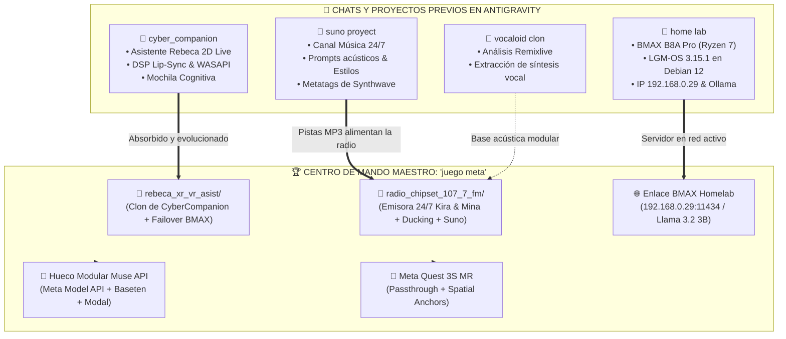

# 🗺️ CENTRO DE MANDO GLOBAL // PROJECT YUI, CALAMAR-NET & HACKATHON META
> **Ecosistema:** El taller de la gatita tech  
> **Operadora:** Raquel D. Torres  
> **Ubicación Canónica:** `c:\Users\asakura\Documents\juego meta\`  
> **Fecha de Consolidación:** 27 de Octubre de 2026 (Hackathon Sprint: Día 2)  
> **Propósito:** Fuente de verdad única y permanente. **Elimina la dispersión mental entre chats y carpetas de la barra lateral de Antigravity.**

---

## 🧭 1. Desahogo de la Barra Lateral: Mapa de Convergencia

Si miras la barra lateral izquierda de Antigravity, ves muchos proyectos y conversaciones abiertas. **Tranquilidad absoluta: todo lo que importaba de cada uno ya ha sido absorbido y centralizado dentro de esta carpeta (`juego meta`)**. 

A continuación tienes el mapa de qué era cada chat y cómo está integrado aquí:



### Tabla de Equivalencias Rápidas:
| Proyecto en Barra Lateral | Chat de Origen | Qué era | Dónde vive ahora (en `juego meta`) | ¿Necesitas volver al chat viejo? |
| :--- | :--- | :--- | :--- | :--- |
| **`cyber_companion`** | *Unificación De Chats* | La asistente de escritorio Rebeca 2D con voz y gestos | En [`rebeca_xr_vr_asist/`](file:///c:/Users/asakura/Documents/juego%20meta/rebeca_xr_vr_asist/) | ❌ **No.** Todo su código y assets están aquí. |
| **`suno proyect`** | *Crear Canal Música 24/7* | Prompts para generar pistas synthwave / rock | Carpeta de pistas: [`radio_chipset_107_7_fm/music/`](file:///c:/Users/asakura/Documents/juego%20meta/radio_chipset_107_7_fm/music/) | ❌ **No.** La música que generes se suelta aquí directo. |
| **`home lab`** | *Creación Servidor NAS* | Montaje del BMAX Ryzen 7, LGM-OS y Ollama | Operativo en red (`192.168.0.29:11434`). Registrado en [`DICCIONARIO_Y_GUIA_SERVIDOR_BMAX.md`](file:///c:/Users/asakura/Documents/home%20lab/docs/DICCIONARIO_Y_GUIA_SERVIDOR_BMAX.md) | ❌ **No.** El servidor ya corre autónomo en su balda. |
| **`vocaloid clon`** | *Clonación Vocaloid* | Investigación de síntesis de voz y Remixlive | Integrado en la modulación dual de Edge-TTS (`Elvira` y `Abril`) | ❌ **No.** La radio ya tiene las voces moduladas. |
| **`juego meta`** | *Preparación Hackathon* | **ESTE CHAT Y ESTA CARPETA** | **Tu único centro de trabajo.** | ✅ **SÍ. Todo se hace desde aquí.** |

---

## 🔌 2. Arquitectura de Proveedores de IA: "El Hueco de Muse"

Hemos dejado implementada una arquitectura desacoplada (*Provider Pattern*) en [`radio_chipset_107_7_fm/config.json`](file:///c:/Users/asakura/Documents/juego%20meta/radio_chipset_107_7_fm/config.json) y [`script_generator.py`](file:///c:/Users/asakura/Documents/juego%20meta/radio_chipset_107_7_fm/core/script_generator.py). 

Puedes alternar entre modelos cambiando una sola línea:

```json
"active_provider": "bmax_local"
```

### Los 3 Niveles de Ejecución:

```
                  ┌─────────────────────────────────────────────────────────┐
                  │              PROVEEDOR ACTIVO EN CONFIG                 │
                  └───────────────────────────┬─────────────────────────────┘
                                              │
                    ┌─────────────────────────┼─────────────────────────┐
                    ▼                         ▼                         ▼
          [ 1. bmax_local ]          [ 2. meta_muse_api ]       [ 3. baseten_muse ]
          ─────────────────          ────────────────────       ───────────────────
          • Motor: Ollama            • Motor: Meta Model API    • Motor: Baseten Endpoint
          • Modelo: llama3.2:3b      • Modelo: muse-spark       • Modelo: muse-spark-open
          • Coste: 0,00 € (Local)    • Coste: 150 $ Créditos    • Coste: 100 $ + 2M TPM
          • ESTADO HOY: ACTIVO       • ESTADO: EN ESPERA        • ESTADO: EN ESPERA
```

### Cómo activar la API de Muse cuando lleguen los créditos:
1. Copia el archivo [`.env.example`](file:///c:/Users/asakura/Documents/juego%20meta/.env.example) como `.env`.
2. Pega tu clave de API en:
   ```env
   META_MODEL_API_KEY=tu_clave_de_150_dolares_aqui
   BASETEN_API_KEY=tu_clave_de_baseten_aqui
   ```
3. En [`config.json`](file:///c:/Users/asakura/Documents/juego%20meta/radio_chipset_107_7_fm/config.json), cambia `"active_provider": "bmax_local"` por `"meta_muse_api"` o `"baseten_muse"`.
4. Si la API externa falla o se corta internet, el sistema hace **fallback automático al BMAX local en milisegundos**. Cero caídas en directo.

---

## 🗂️ 3. Estructura Limpia de la Carpeta `juego meta/`

```
c:\Users\asakura\Documents\juego meta\
├── 00_CENTRO_DE_MANDO_Y_MAPA_CANONICO_GLOBAL.md  <-- ESTE DOCUMENTO (Mapa Maestro)
├── .env.example                                  <-- Plantilla de variables y claves API
├── GUIA_MAESTRA_DESPLIEGUE_HACKATHON_META.md     <-- Guía de entrega y rúbrica para el jurado
├── ARQUITECTURA_MAESTRA_PROJECT_YUI_METAVERSE.md <-- Lore, diseño transmedia y diagramas C4
├── GUIA_CONFIGURACION_QUEST3S.md                 <-- Configuración de Unity, ADB y visor Quest 3S
│
├── entrega_hackathon_meta/                       <-- 🏆 DOSSIER Y DOCUMENTACIÓN FINAL BILINGÜE
│   ├── 01_CHECKPOINT_Y_CHECKLIST_GLOBAL.md       <-- Termómetro de avance y tareas restantes por día (ES)
│   ├── 02_ROADMAP_7_DIAS_HACKATHON.md            <-- Plan diario del 28 oct al 4 nov sin agobios (ES)
│   ├── 03_README_GITHUB_PUBLICO.md               <-- README maestro para GitHub con Prior Work (ES)
│   ├── 04_GUION_Y_STORYBOARD_VIDEO_DEMO_3_MINUTOS.md <-- Guión 180s para el vídeo demo obligatorio (ES)
│   ├── 05_BORRADOR_FORMULARIO_ENTREGA_CEREBRAL_VALLEY.md <-- Textos para copiar a Cerebral Valley (ES)
│   ├── 06_ARQUITECTURA_TECNICA_ECOSISTEMA_YUI.md <-- Whitepaper técnico completo de las 3 capas (ES)
│   └── en/                                       <-- 🌐 OFFICIAL ENGLISH SUBMISSION MIRROR
│       ├── 01_CHECKPOINT_AND_GLOBAL_CHECKLIST.md <-- Status thermometer & master checklist (EN)
│       ├── 02_7_DAY_HACKATHON_ROADMAP.md         <-- Day-by-day 7-day battle roadmap (EN)
│       ├── 03_PUBLIC_GITHUB_README.md            <-- Public GitHub README with Prior Work Disclosure (EN)
│       ├── 04_3_MINUTE_VIDEO_DEMO_SCRIPT_AND_STORYBOARD.md <-- 180s video demo script & storyboard (EN)
│       ├── 05_CEREBRAL_VALLEY_SUBMISSION_FORM_DRAFT.md <-- Official form fields for judges (EN)
│       └── 06_YUI_ECOSYSTEM_TECHNICAL_ARCHITECTURE.md <-- 3-layer architecture technical whitepaper (EN)
│
├── buzon_discord/                                <-- INGESTA AUTOMÁTICA DE INTELIGENCIA DE DISCORD
│   ├── entrantes/                                <-- Suelta aquí cualquier export de chat o nota
│   ├── procesados/                               <-- Historial archivado sin duplicados
│   └── procesar_buzon.py                         <-- Filtro anti-paja y generador de telemetría
│
├── radio_chipset_107_7_fm/                            <-- EMISORA 24/7 (Kira & Mina)
│   ├── config.json                               <-- Selector de proveedor (BMAX / Muse API)
│   ├── launcher.py                               <-- Launcher CLI (--test, --continuous, --event)
│   ├── events_queue.json                         <-- Cola viva de eventos in-game y misiones
│   ├── music/                                    <-- Suelta aquí tus MP3/WAV de Suno
│   ├── cache/                                    <-- Audios generados por las locutoras
│   └── core/
│       ├── script_generator.py                   <-- Guionista multi-agente Llama 3.2 / Muse
│       ├── audio_synthesizer.py                  <-- Síntesis Edge-TTS dual (Elvira & Abril)
│       ├── events_bridge.py                      <-- Inyección de eventos y telemetría
│       └── broadcast_streamer.py                 <-- Bucle 24/7 y audio ducking
│
├── rebeca_xr_vr_asist/                           <-- ASISTENTE DE ESCRITORIO / COMPAÑERA
│   ├── main.py                                   <-- Launcher PySide6 2D Live con Lip-Sync
│   ├── bmax_provider.py                          <-- Conector híbrido BMAX / Gemini / Radio
│   ├── agent_tools.py                            <-- Herramientas de sistema y telemetría
│   └── assets/                                   <-- Sprites, fondos y animaciones
│
├── quest_mr_nexus/                               <-- PROYECTO UNITY 6 // QUEST 3S (SISTEMA PUZZLE)
│   ├── README_PUZZLE_XR.md                       <-- Guía de ensamblado de las 5 piezas y arsenal
│   ├── Packages/manifest.json                    <-- Meta XR Core SDK 69.0.0 + MRUK
│   ├── Assets/Shaders/                           <-- Shaders optimizados para Quest 3S
│   │   ├── SolidLightHologram.shader             <-- Armas de luz sólida Fresnel (0 MB VRAM, 90 FPS)
│   │   └── MRUK_DepthMaskOccluder.shader         <-- Oclusión invisible tras muebles reales
│   └── Assets/Scripts/
│       ├── AR/                                   <-- Oclusión de sala y escaneo MRUK
│       │   └── MRUKOcclusionSetup.cs             <-- Malla oclusora de sofá, tele y paredes
│       ├── Core/                                 <-- Passthrough dinámico, anclajes y LocalizationManager (EN/ES)
│       ├── Companion/                            <-- Nyx compañera holográfica flotante
│       ├── AudioRadio/                           <-- Transistor Radio Chipset 3D y música de combate
│       ├── NetworkBridge/                        <-- Puente Wi-Fi HTTP con BMAX Homelab
│       └── Gameplay/                             <-- Guantelete, Bláster, Arácnidos y Boss Colosal
│
└── kb_xr/                                        <-- Documentación y notas técnicas auxiliares
```

---

## 🧘 4. Protocolo Anti-Sobrecarga para Raquel

1. **No abras más chats para este proyecto:** Todo lo que construyamos para el Hackathon de Meta, para la radio y para Yui se gestiona **dentro de este mismo hilo de conversación**.
2. **Tu único punto de referencia:** Si alguna vez dudas de dónde está un archivo o qué IP tenía el servidor, abre este documento (`00_CENTRO_DE_MANDO_Y_MAPA_CANONICO_GLOBAL.md`).
3. **Tu misión creativa ahora:** 
   * Seguir sacando los temazos en Suno y soltándolos en `radio_chipset_107_7_fm/music/`.
   * Estar atenta al correo por si Meta o Baseten aprueban los créditos.
   * Del resto de código, dependencias y arquitectura técnica me encargo yo paso a paso.
