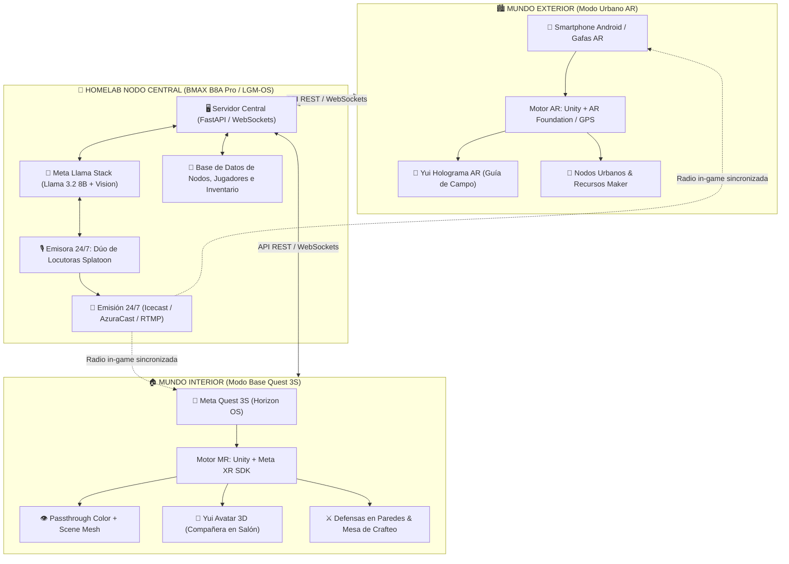
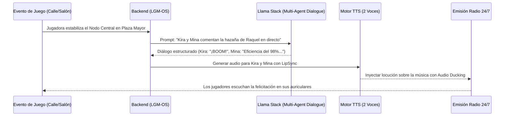

# 🌐 ARQUITECTURA MAESTRA: PROJECT YUI // THE WIRED NEXUS
> **Ecosistema:** El taller de la gatita tech / Bytes y Zarpas  
> **Inspiraciones:** *Sword Art Online (Yui)* + *Splatoon (Dúo de Locutoras)* + *Free Guy* + *Ready Player One* + *Pokémon GO / Monster Hunter Now*  
> **Plataformas Objetivo:** Meta Quest 3S (Realidad Mixta en interiores) + Smartphone / Smartglasses AR (Realidad Aumentada urbana en exteriores) + Servidor BMAX B8A Pro (LGM-OS / Meta Llama Stack)  
> **Autora:** Raquel D. Torres  
> **Fecha:** 22 de Octubre de 2026  

---

## 🧭 1. Resumen Ejecutivo y Visión del Universo

**Project Yui: The Wired Nexus** es un ecosistema transmedia y videojuego híbrido de Realidad Mixta (MR) y Realidad Aumentada (AR) geolocalizada. A diferencia de los juegos tradicionales cerrados en un monitor o en una burbuja de VR aislada, **el mundo físico real de la jugadora es el escenario de juego**:

1. **En la Calle (Modo Móvil / AR Urbano):** Inspirado en *Pokémon GO* y *Monster Hunter Now*, las calles y plazas reales se superponen con la dimensión digital (*The Wired*). La jugadora camina por su ciudad buscando nodos de datos corruptos, recolectando componentes electrónicos virtuales (resistencias, microcontroladores, núcleos de IA) y activando balizas.
2. **En Casa (Modo Meta Quest 3S / Realidad Mixta):** Tu salón o habitación real se convierte en tu taller cibernético y fortaleza. A través del **Passthrough a color**, las paredes y el suelo reales interactúan con portales dimensionales de donde emergen anomalías de código que debes neutralizar con armas de energía. En tu mesa física puedes montar y craftear con tus propias manos las mejoras recolectadas en la calle.
3. **El Núcleo Yui (Compañera IA Persistente):** Inspirada en la IA Yui de *Sword Art Online* y evolucionada a partir de `cyber_companion` (Rebeca 2D Live). Es una entidad inteligente con visión multimodal y voz propia que te acompaña flotando tanto en la calle como en tus Quest 3S. Identifica componentes en el mundo real, advierte de peligros y gestiona tu inventario.
4. **La Emisora Splatoon 24/7 (Dúo de Locutoras Autónomas con Llama Stack):** Dos agentes de IA autónomas con personalidades chispeantes y contrapuestas (*Kira* y *Mina*) que emiten una radio 24/7. Comentan la música, reaccionan en tiempo real a las hazañas de los jugadores en la calle (*«¡Atención netrunners! La operadora Raquel acaba de estabilizar el nodo del sector 4!»*) y transmiten boletines informativos del juego.

---

## 🏛️ 2. Arquitectura Global de Sistemas (Diagrama C4)

---

## 🧚 3. El Factor Yui: Evolución de `cyber_companion`

El proyecto existente en `C:\Users\asakura\Documents\cyber_companion` ya posee el corazón acústico y emocional:
* Máquina de estados finitos (`PetState`: Idle, Think, Talk, Surprise, Happy, Sleep).
* Motor DSP de Lip-Sync en milisegundos (`QAudioDecoder`).
* Telemetría de audio y bajo consumo.

### Transición hacia Project Yui:
1. **Representación Dual (2D / 3D):**
   * **En PC / Escritorio:** Conserva el motor PySide6 ultra-ligero de `cyber_companion`.
   * **En Quest 3S / AR Móvil:** Se instancia como un avatar 3D estilizado (formato VRM / glTF) con shader estilo anime *Cel-Shaded* brillante y partículas de hada/ciberespacio.
2. **Percepción de Entorno (Llama 3.2 Vision):**
   * A través de la cámara del móvil o el passthrough de las Quest 3S, Yui recibe fotogramas clave.
   * **Ejemplo práctico de juego:** Enfocas con la cámara a un componente electrónico real en tu mesa de trabajo (o una resistencia real), Yui lo analiza con Llama Vision:  
     *«Operadora, detecto una resistencia de 220 ohmios y un módulo ESP32. Podemos integrarlo para potenciar el escudo del nodo central.»*

---

## 🎙️ 4. La Radio Splatoon: «Calamar-Net 24/7» (Kira & Mina)

Inspirado en el carisma de las *Calamarzadas* (Callie & Marie) y *Cefalópop* (Pearl & Marina) de *Splatoon*:

| Característica | **Kira (La Netrunner Eléctrica)** | **Mina (La Ingeniera Arcana)** |
| :--- | :--- | :--- |
| **Rol** | Locutora impulsiva, fan del metal/synthwave y del combate frenético | Analista técnica, calmada, sarcástica y estratega del lore |
| **Voz Neural** | Tono brillante, rápido, enérgico (Edge-TTS `es-ES-ElviraNeural` modulada) | Tono maduro, pausado y elegante (Edge-TTS `es-ES-AbrilNeural`) |
| **Rol en el Juego** | Alienta a los jugadores al combate y celebra victorias épicas | Da consejos técnicos de crafteo y analiza anomalías del mapa |

### Bucle de Locución Autónoma:

---

## 🎮 5. Dinámica de Juego Híbrida: Calle vs. Casa

### A. La Calle (AR Móvil — Exploración & Recolección):
* **Mapa de Calor Digital:** La jugadora ve el mapa de su ciudad con estilo oscuro neón (LainOS / Cyberpunk).
* **Puntos de Interés:** Las fuentes, monumentos y parques son "Servidores Locales".
* **Minijuegos de Hackeo:** Acercarse físicamente a menos de 20 metros para sincronizar datos, recolectar partículas de código y limpiar malware.

### B. La Casa (Meta Quest 3S — Taller & Defensa de Base):
* **Mesa de Trabajo Virtual sobre Mesa Real:** La Scene API detecta tu mesa real; sobre ella aparece un holograma interactivo del mapa de la ciudad y el banco de crafteo.
* **Defensa de Salón (Modo Invasión):** Cuando una anomalía masiva infecta un sector, grietas de código dimensional se proyectan en las paredes físicas de tu habitación. Usando los mandos Touch Plus, disparas proyectiles de energía y activas torretas de defensa ancladas en tus muebles reales.

---

## 🗺️ 6. Roadmap de Desarrollo

1. **Fase 1: Vertical Slice para el Meta Hackathon (26 Oct – 04 Nov):**
   * Servidor Llama Stack con el dúo de locutoras comentando eventos.
   * Prototipo en Unity para Quest 3S con Passthrough, avatar de Yui flotante y disparo básico a grietas en la pared.
2. **Fase 2: Integración Urbana (Noviembre 2026):**
   * App móvil AR con geolocalización de nodos urbanos y sincronización de inventario con el servidor BMAX.
3. **Fase 3: Transmedia & Lanzamiento 24/7 (Diciembre 2026):**
   * Emisión pública 24/7 en YouTube/Twitch de la radio impulsada por el homelab.
