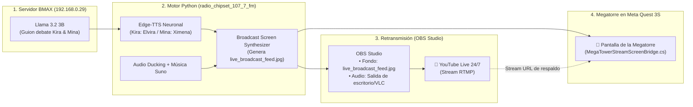

# 📡 GUÍA DE TRINCHERA: EMISIÓN 24/7 (BMAX + OBS + YOUTUBE + MEGATORRE)
> **El Taller de la Gatita Tech** — Flujo de Streaming Autónomo Transmedia  
> **Operadora:** Raquel D. Torres  
> **Arquitectura:** BMAX Bare-Metal (Llama 3.2) ──> Edge-TTS Neuronal ──> OBS Studio ──> YouTube Live ──> Megatorre VR (Unity 6)

---

## 🧭 CÓMO FUNCIONA EL CIRCUITO CERRADO EN TIEMPO REAL



---

## 🛠️ PASO 1: CONFIGURAR LA ESCENA EN OBS STUDIO (3 MINUTOS)

Tu OBS Studio ya está instalado en: `C:\Program Files\obs-studio\bin\64bit\obs64.exe`.

1. **Abre OBS Studio.**
2. En el panel **Fuentes (Sources)** de tu escena principal, agrega:
   - **Fuente 1: Imagen (Image)**
     - Nombre: `Live_Feed_Estudio`
     - Archivo: Marca la casilla **"Descargar imagen cuando no se muestre"** y selecciona:  
       `c:\Users\asakura\Documents\juego meta\radio_chipset_107_7_fm\cache\live_broadcast_feed.jpg`
     - *(Este archivo se actualiza solo en milisegundos con cada réplica de Kira y Mina, mostrando sus subtítulos, el tema musical y el reloj).*
   - **Fuente 2: Captura de Audio de Salida (Audio Output Capture)**
     - Para que OBS recoja la música de Suno y las voces neuronales que reproduce el launcher.
3. En **Ajustes -> Emisión**:
   - Servicio: **YouTube - RTMPS**
   - Clave de retransmisión: Pega la clave de tu evento en directo de YouTube Studio.
4. **Pulsa "Iniciar Transmisión" en OBS.**

---

## 🚀 PASO 2: LANZAR EL MOTOR AUTÓNOMO EN PYTHON

Abre una consola PowerShell y ejecuta:

```bash
cd "c:\Users\asakura\Documents\juego meta\radio_chipset_107_7_fm"
python launcher.py --continuous --lang es
```

### ¿Qué hace este comando de forma continua?
1. Llama por red local a tu **BMAX (`192.168.0.29:11434`)** para que Llama 3.2 genere un diálogo fresco y alegre entre Kira y Mina comentando el taller, el juego y la música.
2. Sintetiza las voces neuronales con Edge-TTS en tiempo récord.
3. Actualiza el archivo `cache/live_broadcast_feed.jpg` con la locutora que está hablando y la pista de audio.
4. Baja el volumen de la música (*audio ducking*) mientras hablan y lo vuelve a subir cuando termina la cápsula.

---

## 🗼 PASO 3: CÓMO SE RECIBE EN LA MEGATORRE DE UNITY (QUEST 3S)

El script [`MegaTowerStreamScreenBridge.cs`](file:///c:/Users/asakura/Documents/juego%20meta/quest_mr_nexus/Assets/Scripts/Core/MegaTowerStreamScreenBridge.cs) está configurado en el cartel gigante de la Megatorre:

1. **Lectura Directa del Feed:**
   - La pantalla de la Megatorre lee la textura activa `live_broadcast_feed.jpg` generada por el motor.
   - Si la transmisión de YouTube está en el aire, también puede configurarse para tomar el flujo RTSP/HLS de YouTube.
2. **Efecto de Oclusión y Glitch:**
   - Cuando el jugador está en la calle virtual explorando antes de la alarma, la pantalla gigante muestra a Kira y Mina en el estudio con las luces neón y los 4 michis.
   - Cuando suena la sirena de la brecha dimensional, la pantalla sufre un pulso de interferencia electromagnética (`TriggerCombatGlitch`).
