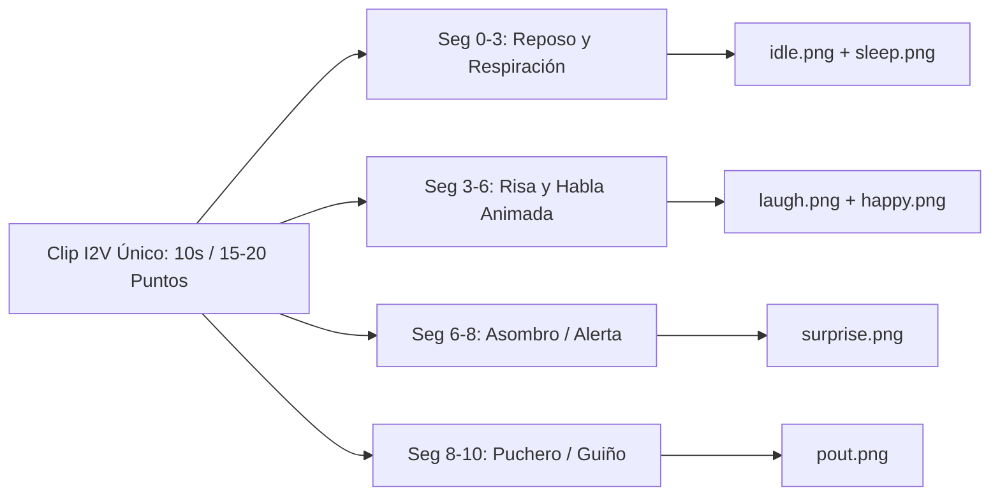

# 🎬 METODOLOGÍA MAESTRA: GENERACIÓN Y EXTRACCIÓN DE SPRITES MEDIANTE IMAGE-TO-VIDEO (I2V)
> **El Taller de la Gatita Tech** — Arquitectura de Animación 2D para Cyber-Companion  
> **Autora / Operadora:** Raquel D. Torres  
> **Protocolo Táctico:** JENY_TACHIKOMA_V2 & TACHIKOMA_NAVI

---

## 🧭 1. EL GRAN DESCUBRIMIENTO: ¿POR QUÉ I2V SUPERA A LA GENERACIÓN ESTÁTICA Y A LIVE2D?

Durante el desarrollo de **Cyber-Companion (Rebeca 2D Live)**, descubrimos que intentar generar fotogramas sueltos mediante generadores de imágenes clásicos (Midjourney, DALL-E 3, Stable Diffusion) produce **deriva anatómica (*drift*)**: cada imagen cambia los mechones de pelo, los tonos de color, los botones de la chaqueta y la proporción del rostro.

Por otro lado, la tecnología tradicional de VTubers (**Live2D Cubism**) exige despiezar al personaje en más de 60 capas PSD independientes, pagar licencias propietarias y pasar semanas configurando mallas de deformación y motores pesados de C++.

### La Solución Triunfadora (El Pipeline de Trinchera):
1. **Imagen Maestra Canónica:** Partir de una única imagen de alta resolución de Rebeca de cuerpo completo sobre verde puro (`#00FF00`).
2. **Generación de Vídeo I2V (Image-to-Video):** Pasar la imagen a un modelo de vídeo generativo con prompts hiper-estrictos de bloqueo de cámara y acción continua. Gracias a la **atención temporal** del modelo, Rebeca conserva su anatomía, ropa y colores al 100% fotograma a fotograma, generando **físicas secundarias orgánicas de forma gratuita** (inercia del cabello, arrugas de la ropa, balanceo natural).
3. **Extracción y Telemetría con Python + OpenCV:** Muestrear los fotogramas clave, estabilizar la columna vertebral, nivelar el suelo a una coordenada matemática exacta (`Y = 767`), limpiar el halo verde mediante matriz de despill y empaquetar directamente en `assets/sprites/`.
4. **Eficiencia Extrema:** 3 vídeos generados = 45 puntos consumidos de una cuota de 1010 (solo un **4,4% de gasto**).

---

## 📜 2. CATÁLOGO DE PROMPTS MAESTROS TRIUNFADORES

Estos son los prompts exactos y validados que produjeron los mejores resultados en la generación de vídeo:

### 🗣️ PROMPT 1: Habla Frontal y Lip-Sync Orgánico (Base de Visemas)
* **Objetivo:** Generar un vídeo de Rebeca de frente hablando con el espectador, con movimientos de boca claros y articulación fonética sin que el cuerpo se desplace.
* **Positive Prompt:**
```text
full body frontal shot, eye level framing. The anime character from the reference image stands firmly in place, talking directly and attentively to the viewer as a friendly AI assistant. Clear and expressive mouth movements with smooth lip-sync modulation, natural phonetic speech articulation. Subtle breathing motion, gentle head movements, occasional friendly eye blinks. Both feet remain planted firmly on the ground, stationary posture, no walking, no stepping. The camera is 100% static and locked, no zoom, no pan, no rotation. Solid pure chroma green screen background #00FF00 remains completely flat, uniform, and still with zero changes. High quality 60fps anime animation.
```
* **Negative Prompt:**
```text
walking, stepping, pacing, turning around, back view, profile view, camera zoom, camera shake, camera movement, distorted mouth, extra teeth, distorted fingers, blurry face, background change, shadows on floor, textures in background, morphing
```

---

### 🎙️ PROMPT 2: Habla Frontal con Modulación Expresiva y Reacciones
* **Objetivo:** Capturar variaciones de sonrisa, risas y modulaciones vocálicas intermedias para emociones secundarias (`HAPPY`, `LAUGH`).
* **Positive Prompt:**
```text
full body frontal shot, eye level framing. The anime character from the reference image stands firmly in place, talking directly and attentively to the viewer as a friendly AI assistant. Clear and expressive mouth movements with smooth lip-sync modulation, natural phonetic speech articulation. Subtle breathing motion, gentle head movements, occasional friendly eye blinks. Both feet remain planted firmly on the ground, stationary posture, no walking, no stepping. The camera is 100% static and locked, no zoom, no pan, no rotation. Solid pure chroma green screen background #00FF00 remains completely flat, uniform, and still with zero changes. High quality 60fps anime animation.
```
* **Negative Prompt:**
```text
walking, stepping, pacing, turning around, back view, profile view, camera zoom, camera shake, camera movement, distorted mouth, extra teeth, distorted fingers, blurry face, background change, shadows on floor, textures in background, morphing
```

---

### 🚶 PROMPT 3: Ciclo de Caminata Táctico en Cinta de Correr (Walk Cycle 90° Derecha)
* **Objetivo:** Caminata continua de perfil estricto hacia la derecha, con zancada natural, balanceo de brazos y rebote orgánico del cabello sincronizado.
* **Positive Prompt:**
```text
Full body side profile view. The anime character from the reference image walks forward steadily in place on an invisible treadmill, strictly moving towards the right side. Natural human walking stride, fluid arm swinging, subtle hair bounce synchronized with steps. Completely static 90 degree side profile camera, locked framing, no camera pans, no camera zooms, no camera rotations. Solid pure chroma green screen background #00FF00 remains completely flat, still, and uniform with zero background changes. Seamless 60fps anime animation walk cycle loop.
```
* **Negative Prompt:**
```text
turning, facing camera, front view, 3/4 view, turning head, camera rotation, camera panning, zooming, 3d perspective shift, distorted feet, multiple legs, extra limbs, background changes, floor patterns, shadows on ground, morphing
```

---

## 🧩 3. PLANTILLA UNIVERSAL PARA EXPANDIR NUEVOS ESTADOS EN EL FUTURO

Para crear cualquier nueva animación que necesitemos en el futuro (ej. teclear en un holograma, celebrar una donación, beber café o postura de alerta táctica), sigue esta estructura de ingeniería de prompts:

### Estructura del Prompt:
```text
[ENCUADRE Y ÁNGULO DE CÁMARA]. The anime character from the reference image [ACCIÓN CONTINUA EN EL SITIO / IN PLACE]. [DETALLES DE MICRO-MOVIMIENTOS: cabello, ojos, manos]. [RESTRICCIÓN ANATÓMICA: pies fijos, postura estacionaria, sin salir del encuadre]. Completely static and locked camera, no camera movement, no zoom, no panning, no camera rotation. Solid pure chroma green screen background #00FF00 remains completely flat, still, and uniform with zero changes. High quality 60fps anime animation loop.
```

### Estructura del Negative Prompt:
```text
walking, stepping, leaving frame, turning around, 3d perspective shift, camera rotation, camera panning, zooming, camera shake, distorted hands, extra limbs, background changes, floor patterns, shadows on floor, textures, morphing, jitter
```

### 💡 Ejemplos Listos para Usar:

#### A. Modo Netrunner (`PetState.THINK`) — Tecleando en Teclado Holográfico
* **Prompt:** `Full body frontal shot, eye level framing. The anime character from the reference image stands firmly in place, typing rapidly and skillfully on a glowing cyan semi-transparent holographic floating keyboard in front of her chest. Focused and intelligent facial expression, subtle head tilts, eyes tracking holographic data streams, occasional natural eye blinks. Both feet planted firmly on ground, stationary posture, no walking. The camera is 100% static and locked, no zoom, no pan. Solid pure chroma green screen background #00FF00 remains completely flat and uniform. High quality 60fps anime animation loop.`
* **Negative Prompt:** `walking, stepping, camera movement, camera shake, zoom, distorted fingers, extra hands, distorted keyboard, background changes, floor shadows, morphing`

#### B. Modo Celebración / Alerta de Stream (`PetState.HAPPY` / `stream_hype`)
* **Prompt:** `Full body or medium shot, eye level framing. The anime character from the reference image stands in place celebrating enthusiastically, smiling warmly, raising one fist in victory and waving friendly to the viewer. Fluid hair bounce, joyful expression, energetic yet stationary posture, feet planted on ground. Completely static locked camera, no camera pans, no zooms. Solid pure chroma green screen background #00FF00 flat and still. High quality 60fps anime animation.`
* **Negative Prompt:** `walking, stepping, turning around, camera movement, distorted face, extra limbs, background change, floor shadows, morphing`

#### C. Modo Descanso / Café (`PetState.IDLE_REST`)
* **Prompt:** `Full body frontal shot, eye level framing. The anime character from the reference image stands relaxed in place, holding a stylish steaming mug of coffee with both hands, taking subtle sips and smiling gently at the viewer. Soft steam rising from the cup, gentle breathing, relaxed posture, feet firmly on ground. Completely static locked camera, no movement. Solid pure chroma green screen background #00FF00 flat and uniform. High quality 60fps anime animation loop.`
* **Negative Prompt:** `walking, walking away, spilling coffee, distorted hands, camera zoom, background changes, floor shadows, morphing`

---

## 🐍 4. EL PIPELINE DE EXTRACCIÓN Y TELEMETRÍA EN PYTHON

Una vez descargado el vídeo generado (`.mp4`), ejecutamos nuestro pipeline en dos fases:

### FASE 1: Mapeo y Detección de Fotogramas Clave
Creamos una cuadrícula de contacto (*contact sheet*) para inspeccionar la boca o las piernas a intervalos de 2 a 4 fotogramas:

```python
import cv2
import numpy as np

def create_contact_sheet(video_path, output_grid_path, step=4, max_frames=60):
    cap = cv2.VideoCapture(video_path)
    frames = []
    idx = 0
    while len(frames) < max_frames:
        ret, frame = cap.read()
        if not ret:
            break
        if idx % step == 0:
            # Añadir etiqueta con el número de fotograma
            labeled = frame.copy()
            cv2.putText(labeled, f"F:{idx}", (20, 50), cv2.FONT_HERSHEY_SIMPLEX, 1.2, (0, 0, 255), 3)
            frames.append(cv2.resize(labeled, (240, 426)))
        idx += 1
    cap.release()
    
    # Montar rejilla de 6 columnas
    rows = []
    cols = 6
    for i in range(0, len(frames), cols):
        chunk = frames[i:i+cols]
        while len(chunk) < cols:
            chunk.append(np.zeros_like(frames[0]))
        rows.append(np.hstack(chunk))
    grid = np.vstack(rows)
    cv2.imwrite(output_grid_path, grid)
    print(f"[+] Rejilla guardada en: {output_grid_path}")
```

---

### FASE 2: Recorte con Despill Verde y Anclaje Métrico de Píxeles
Para evitar halos verdes en el cabello o bordes del cuerpo, y asegurar que el personaje no flote ni vibre:
1. **Extracción con IA (`rembg`):** Aísla la figura en RGBA.
2. **Matriz de Despill Verde:** Si G > max(R, B), corregimos G = int(0.5*R + 0.5*B) en píxeles semitransparentes.
3. **Calibración Anatómica Canónica:**
   - **Canvas del Sprite:** `688 x 768` píxeles.
   - **Altura del Personaje (`target_height`):** `726` píxeles.
   - **Línea de Suelo / Pisada:** `Y = 767` píxeles.
   - **Eje Central de Columna:** `X = 344` píxeles.

```python
import cv2
from PIL import Image
import numpy as np
from rembg import remove, new_session

def process_and_anchor_frame(raw_bgr_frame, target_height=726, ground_y=767, center_x=344):
    # 1. Eliminar croma con rembg
    rgb = cv2.cvtColor(raw_bgr_frame, cv2.COLOR_BGR2RGB)
    pil_img = Image.fromarray(rgb)
    session = new_session("u2net")
    cutout = remove(pil_img, session=session)
    arr = np.array(cutout)

    # 2. Despill Matrix en bordes verdes
    r = arr[:, :, 0].astype(np.float32)
    g = arr[:, :, 1].astype(np.float32)
    b = arr[:, :, 2].astype(np.float32)
    alpha = arr[:, :, 3]

    max_rb = np.maximum(r, b)
    green_excess = g - max_rb
    mask = (green_excess > 0) & (alpha > 0)
    arr[mask, 1] = max_rb[mask]

    # 3. Bounding Box anatómico y reescalado
    alphas = arr[:, :, 3]
    y_indices, x_indices = np.where(alphas > 15)
    y_min, y_max = y_indices.min(), y_indices.max()
    x_min, x_max = x_indices.min(), x_indices.max()

    cropped = Image.fromarray(arr).crop((x_min, y_min, x_max + 1, y_max + 1))
    current_h = y_max - y_min + 1
    scale = target_height / current_h
    new_w = int(cropped.width * scale)
    new_h = int(cropped.height * scale)
    scaled_cropped = cropped.resize((new_w, new_h), Image.Resampling.LANCZOS)

    # 4. Anclaje exacto sobre lienzo canónico de 688x768
    canvas = Image.new("RGBA", (688, 768), (0, 0, 0, 0))
    paste_x = int(center_x - (new_w / 2.0))
    paste_y = int(ground_y - new_h)
    canvas.paste(scaled_cropped, (paste_x, paste_y), scaled_cropped)
    return canvas
```

---

## 🎙️ 5. REGLAS DE ORO PARA EL HABLA Y LIP-SYNC EN CÓDIGO

Aprehendidas durante la resolución de incidencias en `main.py`:

1. **PROHIBIDO insertar `idle.png` dentro del bucle de habla:**
   - La boca debe modular continuamente entre los visemes abiertos y semiabiertos:
     `talk_sequence = [talk_1, talk_2, talk_4, talk_3, talk_5, talk_3, talk_2]`
   - `idle.png` (boca cerrada) SOLO debe mostrarse cuando el reproductor de audio termina (`PlaybackState.StoppedState -> PetState.IDLE`). Meter boca cerrada en mitad de una frase hace parecer que la IA se ahoga o corta el habla mecánicamente.
2. **Cadencia Temporal de Lip-Sync:**
   - Cada visema debe cambiar a **80 ms (12.5 FPS)**: `if self.anim_ticks % 2 == 0: self.anim_frame_index += 1`.
   - 120 ms es demasiado lento para la velocidad del español; 80 ms es el estándar de oro de la animación anime clásica ("on twos").
3. **Cadencia Temporal de Caminata (`WALK`):**
   - Cada paso debe cambiar a **120 ms (8.3 FPS)**: `if self.anim_ticks % 3 == 0: self.anim_frame_index += 1`.
   - Esto produce una zancada firme, acompasada y sin sensación de patinar.

---

## 🚀 7. PROTOCOLO ZERO-WASTE: EL CARRETE DE PRUEBA DE ACTOR (SCREEN TEST REEL)

### La Problemática del Coste en Clientes
En las primeras pruebas masivas, generar vídeos independientes de 5 segundos para cada micro-expresión o emoción individual supuso un consumo de entre **300 y 500 puntos** en plataformas de vídeo generativo (Kling AI, Google Flow). Con una cuota mensual estándar de 1010 puntos, este ritmo agotaría los créditos con apenas 2 o 3 clientes.

### La Solución Táctica: Secuenciación Multi-Expresión en un Único Clip
En lugar de solicitar un vídeo por emoción, aplicamos la técnica cinematográfica del **Screen Test Reel**: agrupamos entre 3 y 4 micro-acciones compatibles en un único clip de 5 a 10 segundos.



#### Ventajas Operativas:
1. **Reducción de Coste del 60% al 75%:** De 8 vídeos (120-160 puntos) a tan solo 2 vídeos de prueba compuesta (30-40 puntos).
2. **Coherencia Anatómica Absoluta:** Todas las expresiones provienen del mismo flujo de atención temporal del generador, eliminando cualquier mínima variación de iluminación o tono entre emociones.
3. **Mapeo de Muestreo Temporal:**
   - **Tramo 1 (0% - 30%):** Postura base, parpadeo y visemas cerrados.
   - **Tramo 2 (30% - 65%):** Clímax emocional (sonrisa abierta, risa o sorpresa).
   - **Tramo 3 (65% - 100%):** Reacción secundaria o resolución (puchero, asombro o guiño cómplice).

---

## 🌈 8. CROMA CLAVE ESPECTRAL Y BLINDAJE NEÓN (#00FFCC)

### El Peligro del Croma Invasivo en Estética Cyberpunk
En personajes con diseño netrunner/cyberpunk, la vestimenta integra circuitos luminosos en cian neón (`#00ffcc`, Hue $\approx 85..95$ en HSV), visores digitales con código y auriculares tácticos.
Los algoritmos estándar de croma verde abarcan rangos amplios ($H \in [35, 85]$). Al intersectar con tonos verde-azulados, **perforan el interior de la ropa, dejando agujeros negros transparentes en las mangas y en los hologramas**.

### La Fórmula Espectral Calibrada:
Para aislar el fondo verde de estudio sin dañar ni un solo circuito neón:
1. **Ventana Espectral Estricta de Verde Puro:**
   - Matiz (Hue): $50 \le H \le 75$ (Verde puro de estudio, descartando cianes $H > 80$ y amarillos $H < 45$).
   - Saturación (Sat): $S \ge 110$ (Exige alta saturación de croma, ignorando ropa oscura o grisácea).
   - Brillo (Val): $V \ge 100$ (Excluye sombras profundas de la ropa).
2. **Despill Táctico Perimetral (Boundary-Only Despill):**
   - El algoritmo de corrección de halo verde (`spill = g - max(r, b)`) se restringe **exclusivamente a los píxeles del borde semitransparente** (`0 < alpha < 250`).
   - Se prohíbe terminantemente alterar píxeles interiores con `alpha == 255`, preservando al 100% el brillo de las líneas luminosas y el texto del visor.

```python
def chroma_key_bgr(bgr: np.ndarray) -> Image.Image:
    hsv = cv2.cvtColor(bgr, cv2.COLOR_BGR2HSV)
    lower_green = np.array([50, 110, 100])
    upper_green = np.array([75, 255, 255])
    green_mask = cv2.inRange(hsv, lower_green, upper_green)
    alpha = cv2.bitwise_not(green_mask)
    alpha_smooth = cv2.GaussianBlur(alpha, (3, 3), 0)

    rgb = cv2.cvtColor(bgr, cv2.COLOR_BGR2RGB)
    rgba = cv2.cvtColor(rgb, cv2.COLOR_RGB2RGBA)
    rgba[:, :, 3] = alpha_smooth

    # Despill exclusivo en el contorno semitransparente
    border_mask = (alpha_smooth > 0) & (alpha_smooth < 250)
    r = rgba[:, :, 0].astype(np.float32)
    g = rgba[:, :, 1].astype(np.float32)
    b = rgba[:, :, 2].astype(np.float32)
    spill = np.clip(g - np.maximum(r, b), 0, 255)
    rgba[:, :, 1] = np.clip(g - spill * (border_mask.astype(np.float32)), 0, 255).astype(np.uint8)

    return Image.fromarray(rgba)
```

---

## 🖥️ 9. SEGREGACIÓN DE PLATÓ VS COMPAÑERA Y GEOMETRÍA DE MESA ($Y=767$, $W=417\text{ px}$)

### Segregación de Estados: `THINK` vs `STREAM_THINK`
Es crítico mantener separadas las dos identidades de la IA:
- **Modo Compañera (Cuerpo Completo):** Rebeca de pie en traje táctico, interactuando con paneles holográficos flotantes en el aire (`think.png`, `think_1.png`, `think_2.png`). Bounding Box centralizado: `bbox=(161, 43, 528, 767)`.
- **Modo Plató Streamer (Escritorio OBS):** Rebeca sentada tras su mesa de streaming con micrófono boom, auriculares, visor digital y teclado mecánico (`stream_think.png`, `stream_think_1.png`, `stream_think_2.png`). Bounding Box: `bbox=(104, 87, 584, 767)`.

### Estandarización de Geometría de Mesa (Zero-Jitter Desk)
Para que las transiciones en OBS Studio no produzcan "saltos" o escalados irregulares de la mesa:
1. **Línea de Suelo / Borde Inferior:** Fijada rigurosamente en $Y = 767$ para un lienzo de $688 \times 768$.
2. **Ancho de Mesa Canónico:** $417\text{ px}$ en el corte horizontal.
3. Si un estado secundario de plató (como `desk_movie.png` con palomitas) se genera con un encuadre más cercano o lejano, se aplica reescalado proporcional automático para igualar el ancho de mesa a $417\text{ px}$ antes de anclar en $Y=767$.

---

## 🔄 10. ARQUITECTURA DE BUCLES MULTI-FOTOGRAMA EN TIEMPO REAL

El motor `main.py` incorpora resolución jerárquica con prefijos de plató y soporte para animaciones en bucle de múltiples fotogramas:

```text
assets/sprites/
├── think.png / think_1..2.png         -> Bucle de tecleo holográfico (Cuerpo entero)
├── stream_think.png / 1..2.png       -> Bucle de tecleo mecánico y visor (Plató OBS)
├── movie.png / movie_1..3.png         -> Bucle comiendo palomitas y mirando pantalla
├── desk_movie.png                     -> Variante con mesa fija de streaming
├── music.png / music_1..2.png         -> Bucle balanceo musical con cascos
├── stream_idle.png / stream_talk_1..3 -> Visemas de locución para micrófono de estudio
└── walk_1..8.png                      -> Ciclo de caminata bidireccional
```

### Resolución Dinámica por Prefijo en `CyberPetWindow`:
1. Si el operador activa el plató `streamer`, el motor busca primero `{prefix}{estado}_{i}.png` (ej. `stream_think_1.png`).
2. Si no existe, realiza un *fallback* transparente a `{estado}_{i}.png` o `{estado}.png`.
3. Esto permite incorporar cualquier vestuario o plató futuro (`cyberpunk_`, `maid_`, `pilot_`) sin modificar una sola línea de lógica del núcleo.

---

*Compilación finalizada. Metodología maestra actualizada y sellada para el Taller de la Gatita Tech. Esperando nuevas directivas, Mayor.*
