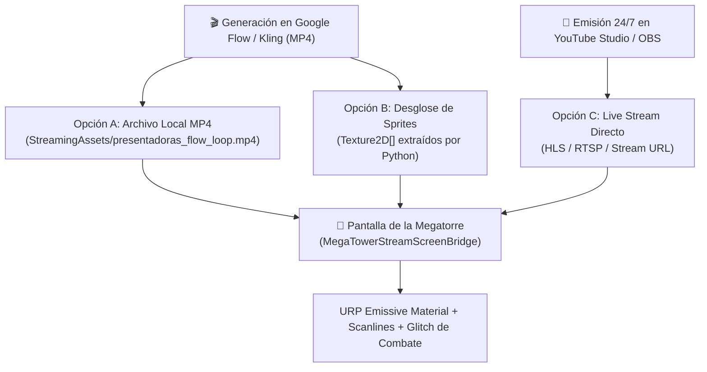

# 🎬 CATÁLOGO MAESTRO: PROMPTS PARA GOOGLE FLOW / KLING AI (PRESENTADORAS 24/7)
> **El Taller de la Gatita Tech** — Producción Audiovisual Cyberpunk  
> **Destino 1:** Emisión continua 24/7 en YouTube (*Calamar-Net // Wired FM*)  
> **Destino 2:** Retransmisión Holográfica en la Pantalla Gigante de la Megatorre en Unity 6 (Meta Quest 3S)  
> **Presentadoras:** Kira (Locutora enérgica, pelo carmesí, netrunner) & Mina (Analista táctica, seria y elegante)  
> **Configuración en Flow / Kling:** Modo Image-to-Video (I2V), 16:9 widescreen, 24fps / 60fps, Loop activado.

---

## 📌 PARTE 1: PROMPTS MAESTROS IMAGE-TO-VIDEO (I2V)

### 🎙️ BUCLE 1: Kira en Directo ante el Micrófono (Modo On-Air Hype)
> **Imagen de Entrada (Reference):** [`rebeca_streamer_reference_green.png`](file:///c:/Users/asakura/Documents/juego%20meta/rebeca_xr_vr_asist/assets/rebeca_streamer_reference_green.png) o [`kira_portrait.png`](file:///c:/Users/asakura/Documents/juego%20meta/quest_mr_nexus/Assets/Sprites/RadioStudio/kira_portrait.png)  
> **Propósito:** Mostrar a Kira hablando con pasión al micrófono, gesticulando con la cabeza y el pelo al ritmo del beat de Suno.

```text
[PROMPT POSITIVO]:
Cinematic medium close-up, eye-level framing, 16:9 aspect ratio. The vibrant red-haired anime cyberpunk female radio host from the reference image sits in front of a professional broadcasting microphone. She talks with energetic rhythm, expressive facial emotions, smooth lip-sync articulation, and natural subtle head bobs reacting to energetic electronic beats. Subtle ambient breathing motion, lively purple-red eye glances, occasional friendly confident smiles, and gentle fluid swaying of her ponytail hair. Both shoulders stay in frame, stationary seated posture. The camera is 100% static and locked, zero camera shake, zero zoom, zero pan. Vibrant cyberpunk radio station studio with soft neon cyan and magenta background lights, subtle drifting volumetric dust motes, clean hard-surface consoles. Seamless loop, ultra high quality anime aesthetic, 60fps fluid motion.

[NEGATIVE PROMPT]:
leaving seat, standing up, walking, camera motion, camera pan, camera zoom, sudden 3d angle rotation, morphing face, distorted lips, extra teeth, extra arms, blurry eyes, frame flickering, glitching clothes, messy lines.
```

---

### 🎧 BUCLE 2: Mina Analizando Datos y Escuchando la Sintonía (Modo Tactical Co-Host)
> **Imagen de Entrada (Reference):** Retrato táctico de Mina o captura con cascos de estudio.  
> **Propósito:** Mina atenta a los monitores holográficos, asintiendo con ironía suave mientras Kira habla o suena una pista Lo-Fi.

```text
[PROMPT POSITIVO]:
Medium close-up shot, 16:9 widescreen composition. An elegant, intelligent anime female cybersecurity analyst and co-host with sleek dark hair and glowing subtle cybernetic ear comms. She sits attentively at her terminal, listening to audio telemetry, giving subtle calm nods, thoughtful facial expressions, slight ironic smiles, and gentle periodic eye blinks. Refined and poised posture, hands calmly resting near holographic diagnostic panels, subtle chest breathing motion. The camera remains completely still, locked tripod shot with no motion or perspective drift. Cyberpunk server room background with glowing vertical data racks, deep navy and emerald LED accents. Smooth looping motion, crisp digital clean lines, high-end anime production.

[NEGATIVE PROMPT]:
fast frantic movement, waving arms, standing up, head turning completely away, camera rotation, camera shake, distorted fingers, jittery movement, temporal inconsistency, background morphing.
```

---

### 🐾 BUCLE 3: El Plató Completo con Kira y los 4 Michis del Taller (Modo Estudio General)
> **Imagen de Entrada (Reference):** [`estudio_gatita_tech_16_9.jpg`](file:///c:/Users/asakura/Documents/suno%20proyect/estudio_gatita_tech_16_9.jpg)  
> **Propósito:** Plano general del estudio de mezclas para interludios musicales en la emisión y para verse desde la calle del juego.

```text
[PROMPT POSITIVO]:
Wide-angle 16:9 studio view. The red-haired producer anime girl sits in the center adjusting faders on the glowing illuminated mixing console with subtle precise finger motions. The calico cat sleeping on top of the left studio monitor breathes gently in rhythmic slumber. The ginger striped cat on the analog synthesizers turns its head slowly with curious calm blinking eyes. The cybernetic black cat curled on the mixing desk has soft neon cyan circuitry lines pulsing gently with light. Floating holographic energy spheres levitate slowly with smooth vertical bobbing. Camera is strictly stationary and locked, no movement, no zooming. Atmospheric studio volumetric light beams, glowing runic equalizer bars, warm anime aesthetic, perfect seamless 24fps looping animation.

[NEGATIVE PROMPT]:
cats jumping, running, people walking across the room, violent shaking, camera panning, perspective deformation, sudden lighting flashes, low resolution, artifacts, stuttering loop.
```

---

### ⚠️ BUCLE 4: Alerta de Brecha y Glitch (Modo Transmisión de Emergencia)
> **Imagen de Entrada (Reference):** [`tex_billboard_glitch.png`](file:///c:/Users/asakura/Documents/juego%20meta/quest_mr_nexus/Assets/Resources/Textures/Environment/tex_billboard_glitch.png) o [`cyberpunk_tactical_workshop_arena.jpg`](file:///c:/Users/asakura/Documents/juego%20meta/quest_mr_nexus/Assets/Sprites/RadioStudio/cyberpunk_tactical_workshop_arena.jpg)  
> **Propósito:** Cuando se activa la alarma sísmica en el juego y la Megatorre anuncia la llegada del Boss Titán.

```text
[PROMPT POSITIVO]:
Cyberpunk emergency broadcast signal, 16:9 widescreen. The broadcast screen displays stylized animated glitch scanlines, chromatic aberration shifts in vibrant magenta (#FF007F) and electric cyan (#00FFCC), flashing emergency Kanji warning signs, audio equalizer waveform spikes flickering rapidly, and static holographic transmission noise. Digital data rain cascade, CRT screen curvature feel, fast-paced technological emergency alert loop, locked framing, high visual impact.

[NEGATIVE PROMPT]:
solid black screen, calm static image, slow fade, 3D camera spinning, organic animals, text unreadable, low frame rate.
```

---

## 📡 PARTE 2: ENLACE TÉCNICO CON LA PANTALLA DE LA MEGATORRE EN UNITY

Hemos creado el componente especializado:  
[`MegaTowerStreamScreenBridge.cs`](file:///c:/Users/asakura/Documents/juego%20meta/quest_mr_nexus/Assets/Scripts/Core/MegaTowerStreamScreenBridge.cs)

### 3 Opciones para Conectar el Vídeo a la Pantalla Gigante:



### Configuración Paso a Paso en Unity 6:
1. **Asignar el Script:** Selecciona el objeto `Billboard_RadioChipset_Screen` en la jerarquía de Unity y agrégale el componente `MegaTowerStreamScreenBridge`.
2. **Si usas los clips generados por Flow (Recomendado para Quest 3S):**
   - Guarda el archivo exportado (ej: `presentadoras_loop.mp4`) dentro de la carpeta:  
     `quest_mr_nexus/Assets/StreamingAssets/presentadoras_loop.mp4`.
   - En el inspector de `MegaTowerStreamScreenBridge`, selecciona `Feed Source: LocalVideoLoop` y escribe el nombre del archivo.
3. **Audio Sincronizado:** El script utiliza `RenderTexture` para los gráficos y deja los canales de audio libres para que la voz 3D provenga del componente de la radio transistor o de los altavoces de la calle.
4. **Reactividad al Combate:** Cada vez que el jugador dispara o aparece una brecha, llama a:
   `GetComponent<MegaTowerStreamScreenBridge>().TriggerCombatGlitch();` para que la pantalla parpadee con estática cibernética en tiempo real.
