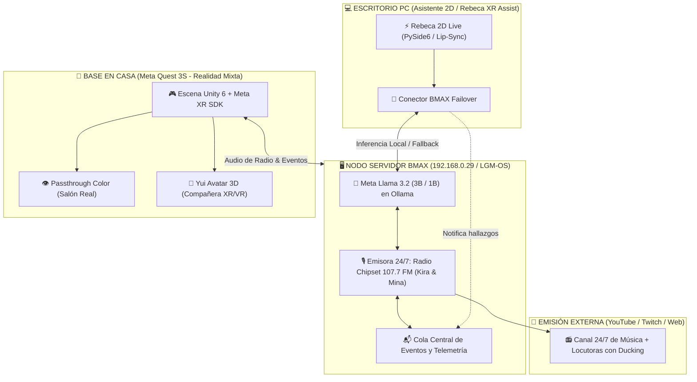

# 🏆 GUÍA MAESTRA DE DESPLIEGUE // META GLOBAL AI DEVELOPER HACKATHON
> **Proyecto:** Project Yui: The Wired Nexus & Radio Chipset 107.7 FM 24/7  
> **Convocatoria:** Cerebral Valley & Meta AI Hackathon (26 Oct – 04 Nov 2026)  
> **Track:** Indie Developer Track  
> **Autora:** Raquel D. Torres (El taller de la gatita tech / Bytes y Zarpas)  
> **Hardware:** Mini PC BMAX B8A Pro (Ryzen 7 8745HS, LGM-OS) + Meta Quest 3S + Smartphone  

---

## 🧭 1. Resumen de la Arquitectura Unificada (El "Todo en Uno")

Para el jurado de Meta, el proyecto se presenta como un ecosistema transmedia cohesionado donde la IA no es un chatbot estático, sino una entidad viva que comparte cerebro y contexto a través de tres pilares:



---

## 🎙️ 2. Módulo de Radio 24/7: Radio Chipset 107.7 FM (`radio_chipset_107_7_fm/`)

Ubicación: `c:\Users\asakura\Documents\juego meta\radio_chipset_107_7_fm\`

### Personalidades de las Locutoras:
* **Kira:** Voz `es-ES-ElviraNeural` (rápida, +10% rate, +4Hz pitch). Netrunner impulsiva, apasionada del synthwave y del combate frenético.
* **Mina:** Voz `es-ES-AbrilNeural` (elegante, calmada, analítica, -2Hz pitch). Analista técnica y de ciberseguridad con humor irónico.

### Comandos de Ejecución:
1. **Lanzar una cápsula de prueba única entre Kira y Mina:**
   ```powershell
   cd "c:\Users\asakura\Documents\juego meta\radio_chipset_107_7_fm"
   python launcher.py --test
   ```
2. **Inyectar un evento en la radio (para que lo comenten en directo):**
   ```powershell
   python launcher.py --event "Raquel ha derrotado al boss de código en el distrito centro" --category game_event
   ```
3. **Iniciar la emisión continua 24/7:**
   ```powershell
   python launcher.py --continuous
   ```

---

## 🧚 3. Asistente XR/VR: Rebeca (`rebeca_xr_vr_asist/`)

Ubicación: `c:\Users\asakura\Documents\juego meta\rebeca_xr_vr_asist\`

* Clonado y adaptado desde `cyber_companion` para el ecosistema del juego.
* **Conector BMAX (`bmax_provider.py`):**
  * Consulta primero a `http://192.168.0.29:11434` con el modelo `llama3.2:3b`.
  * Si el servidor no responde en 8 segundos, conmuta automáticamente a Google Gemini sin cortar la conversación.
  * Inyecta automáticamente los eventos detectados en la cola de la radio `events_queue.json`.

---

## 🥽 4. Escena de Realidad Mixta en Meta Quest 3S

Ubicación de assets y guías: `c:\Users\asakura\Documents\juego meta\`
* **Guía técnica detallada:** [`GUIA_CONFIGURACION_QUEST3S.md`](file:///c:/Users/asakura/Documents/juego%20meta/GUIA_CONFIGURACION_QUEST3S.md)
* **Requisitos en Unity Hub:**
  1. Crear proyecto **3D (URP)**.
  2. Switch Platform -> **Android** (Texture Compression: **ASTC**).
  3. Package Manager -> Instalar `com.meta.xr.sdk.all`.
  4. Project Setup Tool -> Pulsar **Fix All**.
  5. Building Blocks -> Arrastrar **Camera Rig** + **Passthrough** + **Spatial Anchors**.

---

## 📅 5. Checklist de Entrega del Hackathon (Límite: 04 Noviembre 2026)

- [x] Servidor BMAX bare-metal con LGM-OS y Docker activo.
- [x] Modelo oficial de Meta (`llama3.2:3b`) descargado y respondiendo en el NVMe.
- [x] Motor multi-agente de radio con guion dinámico y síntesis dual (Kira & Mina).
- [x] Ducking de audio y pasarela de eventos del juego.
- [x] Copia y adaptación de `rebeca_xr_vr_asist` con failover a BMAX.
- [ ] Creación de la escena base en Unity 6 para Quest 3S con Passthrough.
- [ ] Grabación del vídeo gameplay/demo de 2 minutos desde dentro del visor.
- [ ] Publicación del repositorio oficial en GitHub con licencia MIT y C4 Architecture.
