```mermaid
flowchart LR
    D3["Mié 28 Oct<br>Día 3: Audio & Taller Pt. 2"] --> D4["Jue 29 Oct<br>Día 4: Escena Unity MR"]
    D4 --> D5["Vie 30 Oct<br>Día 5: Prueba en Quest 3S"]
    D5 --> D6["Sáb 31 Oct<br>Día 6: Grabación Clips"]
    D6 --> D7["Dom 1 Nov<br>Día 7: Montaje Vídeo"]
    D7 --> D8["Lun 2 Nov<br>Día 8: GitHub & Readme"]
    D8 --> D9["Mar 3 Nov<br>Día 9: Borrador Entrega"]
    D9 --> D10["Mié 4 Nov<br>Día 10: Pulido & Envío"]
```

# 📅 ROADMAP DE 7 DÍAS // META HACKATHON 2026
> **Ecosistema:** *El taller de la gatita tech*  
> **Filosofía:** Avance constante sin quemarse la cabeza, dividiendo el reto en micro-victorias diarias.  
> **Deadline Inflexible:** Jueves 5 de Noviembre, 03:00 AM España (Miércoles 4 nov, 9:00 PM ET).

---

---

### 🗓️ DÍA 3: Miércoles, 28 de Octubre (HOY)
**Foco:** Integración de Música Suno + Taller Oficial Meta Pt. 2
- [x] Consolidar la inteligencia del Discord y generar el dossier ejecutivo.
- [x] Integrar los shaders y scripts definitivos de Realidad Mixta (Luz sólida, Oclusión MRUK, Arácnidos).
- [ ] **17:00 CET (12:00 PM ET):** Atender o revisar el taller oficial *"Agents 101 Pt. 2"* con Suraj Subramanian.
- [ ] Colocar los archivos de música descargados de Suno en `quest_mr_nexus/Assets/Audio/Battle/` y `radio_chipset_broadcast/music/`.
- [ ] Ejecutar el test de audio de la radio (`python launcher.py --test`).

---

### 🗓️ DÍA 4: Jueves, 29 de Octubre
**Foco:** Configuración de Escena y Materiales en Unity 6
- [ ] Refrescar Unity para certificar consola limpia (cero errores `CS0246`).
- [ ] Crear los materiales URP para las armas holográficas del guantelete y la oclusión invisible.
- [ ] Configurar el GameObject `RoomOccluder` con `MRUKOcclusionSetup.cs`.
- [ ] Ensamblar la escena de demostración:
  - Cámara `OVRCameraRig` con passthrough activado.
  - Guantelete en el mando derecho.
  - Radio transistor sobre la mesa virtual.
  - Spawner de arácnidos en la pared física.

---

### 🗓️ DÍA 5: Viernes, 30 de Octubre
**Foco:** Despliegue en Meta Quest 3S y Prueba de Salón
- [ ] Conectar las Quest 3S por cable Link o compilar APK de desarrollo.
- [ ] Probar el passthrough a color en el salón de casa:
  - Verificar que los arácnidos caminan pegados a las paredes reales.
  - Verificar que al pasar detrás de la televisión o el sofá, los muebles los tapan (oclusión MRUK).
  - Comprobar la respuesta háptica al disparar con el bláster.
- [ ] Anotar los ajustes de velocidad y sonido necesarios.

---

### 🗓️ DÍA 6: Sábado, 31 de Octubre
**Foco:** Grabación de Metraje para la Demo (3 Minutos de Oro)
- [ ] Grabar capturas de vídeo en primera persona desde el menú interno de las Quest 3S:
  - Toma 1: Activación del passthrough y aparición del transistor de radio con música de Suno.
  - Toma 2: Cambio de armas en el guantelete (bláster -> sable -> ballesta).
  - Toma 3: Combate contra arácnidos de pared con oclusión visible detrás de un mueble real.
  - Toma 4: Aparición de la Mente Colmena, tinte violeta en las paredes y música de Boss.
- [ ] Grabar toma corta con el móvil del Mini PC BMAX Homelab en el salón y la consola recibiendo los eventos en tiempo real.

---

### 🗓️ DÍA 7: Domingo, 1 de Noviembre
**Foco:** Edición de Vídeo en Kdenlive
- [ ] Montar los clips en **Kdenlive** ajustando la duración exacta a **2:45 - 2:55 minutos** (por debajo del límite estricto de 3:00).
- [ ] Añadir títulos limpios Neo-Cyberpunk explicando qué tecnología de Meta interviene en cada plano:
  - *"Meta Quest 3S Passthrough & MRUK Spatial Occlusion"*
  - *"Autonomous Pirate Radio // Dual Neural DJ hosts"*
  - *"Local Bare-Metal Server // Llama 3.2 3B On-Premise Engine"*
- [ ] Grabar voz en off o generar locución neuronal en inglés claro con subtítulos en inglés.
- [ ] Renderizar en 1080p 60fps y subir a YouTube/Vimeo en modo oculto/público.

---

### 🗓️ DÍA 8: Lunes, 2 de Noviembre
**Foco:** Creación del Repositorio Público en GitHub
- [ ] Crear repositorio público en GitHub (ej: `project-yui-wired-nexus`).
- [ ] Subir el código limpio (excluyendo carpetas pesadas `Library/` mediante `.gitignore`).
- [ ] Publicar el `README.md` maestro con:
  - Insignias (badges) de Unity 6, Meta XR, Llama 3.2 y Python.
  - Declaración obligatoria de *Prior Work*.
  - Diagrama de arquitectura del ecosistema.
  - Enlace al vídeo demo.

---

### 🗓️ DÍA 9: Martes, 3 de Noviembre
**Foco:** Rellenar Borrador del Formulario de Cerebral Valley
- [ ] Abrir el formulario oficial de entrega: [https://cerebralvalley.ai/e/meta-ai-developer-hackathon/hackathon/submit](https://cerebralvalley.ai/e/meta-ai-developer-hackathon/hackathon/submit).
- [ ] Pegar las respuestas preparadas del documento `05_BORRADOR_FORMULARIO_ENTREGA_CEREBRAL_VALLEY.md`.
- [ ] Enlazar el repositorio de GitHub y el vídeo demo.
- [ ] Guardar borrador (recordando que el sistema permite editarlo hasta el último minuto).

---

### 🗓️ DÍA 10: Miércoles, 4 de Noviembre (DÍA DE LA VICTORIA)
**Foco:** Doble Chequeo y Envío Final
- [ ] Comprobar que el enlace del vídeo funciona sin iniciar sesión (en modo incógnito).
- [ ] Comprobar que el repositorio de GitHub es 100% público y se leen todos los diagramas.
- [ ] Enviar formalmente antes de las **21:00 ET (03:00 AM del 5 de Noviembre en España)**.
- [ ] ¡Celebrarlo con los 11 gatos y descansar con la satisfacción del deber cumplido!
