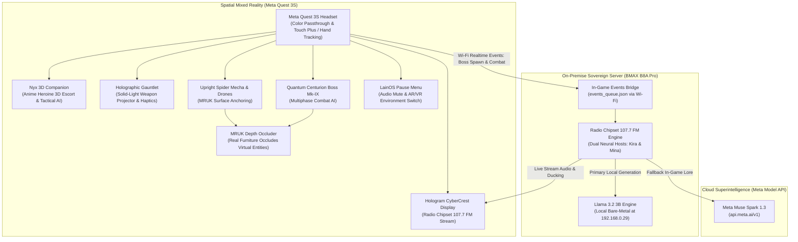

# 🌐 Project Yui: The Wired Nexus & Radio Chipset 107.7 FM
> **Meta Global AI Developer Hackathon 2026**  
> **Track:** Indie Developer Track ($150,000) & Creative Superintelligence ($5,000)  
> **Autora:** Raquel D. Torres (*El taller de la gatita tech*)  
> **Hardware Objetivo:** Meta Quest 3S / Quest 3 + Servidor Soberano On-Premise BMAX B8A Pro  
> **Motor:** Unity 6 LTS (6000.6.5f1) + Universal Render Pipeline (URP)  
> **Modelos IA:** Meta Llama 3.2 3B (Local bare-metal vía Ollama) + Meta Muse Spark 1.3 (`https://api.meta.ai/v1`)  

[](https://www.meta.com/quest/quest-3s/)
[](https://unity.com/)
[](https://llama.meta.com/)
[](LICENSE)

---

## 📽️ Demostración en Vídeo (3 Minutos)
[](https://youtube.com)  
*(Gameplay completo en passthrough a color real, compañera anime 3D Nyx, combate contra arácnidos mecha y boss Quantum Centurion, streaming en vivo de Radio Chipset 107.7 FM y menú interactivo LainOS).*

---

## 📜 Declaración de Trabajo Previo y Contribuciones del Hackathon
*En estricto cumplimiento con la normativa del Meta Global AI Developer Hackathon 2026 sobre bases previas y desarrollo en plazo:*

### Base Previa al Hackathon:
- **Prototipo preliminar de escritorio (`cyber_companion`):** Experimento previo en PyQt/PySide con monitorización básica de hardware y diálogo simple.
- **Servidor Físico:** Despliegue bare-metal de Debian 12 (LGM-OS 3.15.1) en el mini PC BMAX B8A Pro.

### Nuevas Contribuciones (100% Desarrollado Durante el Hackathon: 26 Oct – 4 Nov 2026):
1. **Pila Completa de Realidad Mixta en Unity 6 (`quest_mr_nexus/`):**
   - **Guantelete Holográfico de Luz Sólida** (`HolographicGauntlet.cs`) con perfiles hápticos avanzados para Meta Touch Plus y seguimiento óptico de manos (*Hand Tracking* vía `XRHandAnchorFollower.cs`).
   - **Compañera Heroína Anime 3D Nyx** (`Nyx_Companion_Anime3D.fbx` + `NyxFloatingCompanion.cs`): Escala táctica 0.55m, cabello rojo, escolta flotante dinámica, animaciones de flotación procedural y diálogos reactivos a eventos de combate.
   - **Enemigos de Combate 3D y Jefes:**
     - **Arácnido Mecha Vertical** (`SpiderDrone_Mecha_3D.fbx` + `NeoCyberSpiderDroneAI.cs`): IA bípeda y trepadora adaptada a superficies escaneadas (`WALL_FACE` y `FLOOR`) con orientación erguida y disparo de proyectiles de energía.
     - **Jefe Titán Quantum Centurion Mk-IX** (`QuantumCenturion_Boss_3D.fbx` + `QuantumCenturionBossAI.cs`): Jefe mecha bípedo acorazado con patrones de ataque multifase, tajos de espada de plasma, barreras defensivas y ráfagas pesadas.
   - **Emisión en Directo Radio Chipset 107.7 FM** (`HologramCyberCrestDisplay.cs`): Reproductor holográfico 16:9 con streaming de YouTube (`https://www.youtube.com/embed/j_bLVMldHsA`) y atenuación de audio en vivo (*audio ducking*).
   - **Menú de Pausa Interactivo LainOS** (`PauseMenuController.cs`): Interfaz visual cyberpunk con toggle de silenciado de audio local (`[M]`), alternancia inmediata de entorno AR/VR y controles de reanudación y salida.
   - **Aislamiento Estricto de Entornos AR / VR** (`CyberRoomDecorator3D.cs`): Gestión limpia entre el salón físico passthrough y el bulevar cibernético completo NeoEclipse, con permisos de escena automáticos (`requestScenePermissionOnStartup: 1`).
   - **Sistema de Oclusión Espacial Real** (`MRUKOcclusionSetup.cs` + `MRUK_DepthMaskOccluder.shader`): Uso del Meta Mixed Reality Utility Kit (MRUK) para que los muebles reales (sofás, mesas, monitores) oculten físicamente los elementos virtuales a 90 FPS.
2. **Motor Autónomo de Radio Pirata 24/7 (`radio_chipset_broadcast/`):**
   - Emisión dual con locutoras neuronales (*Kira & Mina*) integrando *audio ducking* en tiempo real sobre pistas sonoras generadas con Suno AI.
   - Puente de eventos en tiempo real (`events_bridge.py`) que escucha logros de combate del Quest 3S por Wi-Fi local.
   - Cliente fallback multiproveedor: Meta Llama 3.2 3B en local y Meta Muse Spark 1.3 en cloud (`api.meta.ai/v1`).
3. **Código 100% Bilingüe Simétrico (ES / EN) y Cero Secretos:**
   - 48 scripts de C# y utilidades Python completamente comentados en español e inglés.
   - Blindaje exhaustivo de variables de entorno, credenciales e infraestructura gitignore.

---

## 🏛️ Arquitectura del Sistema



---

## 🎮 Innovaciones Clave

### 1. Compañera Anime 3D Interactiva (Nyx)
Nyx acompaña al jugador en escala táctica (0.55m), flotando suavemente en su flanco izquierdo. Cuenta con cabello carmesí estilizado, shaders optimizados sin sobrecoste de texturas pesadas y respuestas tácticas inmediatas en función del estado de combate y del entorno real.

### 2. Combate Espacial 3D y Oclusión Física Real (MRUK)
Los arácnidos mecha se desplazan con orientación erguida y vertical sobre paredes y suelos reales escaneados por MRUK. Cuando se posicionan tras un sofá o mesa real, la máscara de profundidad garantiza que los objetos físicos reales oculten a los enemigos digitales, garantizando presencia espacial a 90 FPS estables.

### 3. Streaming en Vivo de Radio Chipset 107.7 FM
Directamente integrado en el display holográfico 16:9 (`Hologram_CyberCrest_Display`), reproduce la emisión continua de Radio Chipset 107.7 FM con atenuación de volumen automática (*audio ducking*) durante las intervenciones de las locutoras y los momentos de combate.

### 4. Menú de Pausa Estilo LainOS con Control Total
Al pulsar `[M]` o el botón del menú de pausa, el jugador puede silenciar los efectos ambientales locales para disfrutar exclusivamente de la emisión de radio, o alternar instantáneamente entre la Realidad Aumentada del salón y el Bulevar Cibernético NeoEclipse en VR inmersiva.

### 5. Soberanía Local con Llama 3.2 3B
Cero dependencia de nubes cerradas para la lógica principal. Toda la inferencia neuronal de combate y las interacciones de radio se procesan en el cluster físico del taller mediante el modelo de pesos abiertos de Meta Llama 3.2 3B.

---

## 🚀 Guía de Instalación y Ejecución

### Compilación y Ejecución en Meta Quest 3S (Unity 6)
1. Abrir **Unity Hub** y añadir el proyecto `quest_mr_nexus/` con **Unity 6 LTS (6000.6.5f1)**.
2. Comprobar que en *Project Settings* están activos **Universal Render Pipeline (URP)** y **Meta XR All-In-One SDK**.
3. Abrir la escena principal `Assets/MainMRScene.unity`.
4. Conectar las Meta Quest 3S por USB-C o Meta Quest Link y seleccionar **Build & Run** hacia Android.

### Ejecución del Servidor Autónomo de Radio
```bash
cd radio_chipset_broadcast
pip install -r requirements.txt
python launcher.py --test        # Comprobación de audio con ducking
python launcher.py --continuous  # Ejecución de la emisión 24/7
```

---

## 👥 Autoría y Créditos
- **Autora Principal & Arquitecta:** Raquel D. Torres (*El taller de la gatita tech*).
- **Desarrollado para:** Meta Global AI Developer Hackathon (26 de octubre – 4 de noviembre de 2026).
- **Agradecimientos:** Meta Superintelligence Labs & Cerebral Valley por el acceso al Meta XR SDK y las APIs de Meta.
