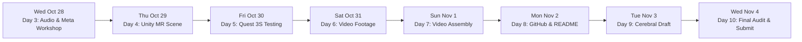

# 📅 7-DAY BATTLE ROADMAP // META HACKATHON 2026
> **Ecosystem:** *El taller de la gatita tech*  
> **Guiding Principle:** Disciplined, sustainable daily execution without burnout. Breaking down the vision into atomic daily wins.  
> **Strict Deadline:** Thursday, November 5 at 03:00 AM CET (Wednesday, Nov 4 at 9:00 PM ET).

---

---

### 🗓️ DAY 3: Wednesday, October 28 (TODAY)
**Focus:** Suno Music Ingestion, Bilingual Radio Tuning & Official Meta Workshop
- [x] Consolidate Discord intelligence and generate official submission dossier.
- [x] Integrate single-pass Solid Light HLSL shader, MRUK Depth-Mask occluder, and spider drone AI.
- [x] Direct zero-copy symlink/path configuration to Suno production tracks (`c:/Users/asakura/Documents/suno proyect/radio_assets/music_tracks`).
- [x] Categorize battle tracks inside Unity (`Assets/Audio/Battle/Normal`, `Boss`, `FinalBoss`).
- [x] Dual-language engine implementation (English & Spanish neural voices for Kira and Mina).
- [x] Pass end-to-end radio synthesis test (`python launcher.py --test --lang en`).
- [ ] **17:00 CET (12:00 PM ET):** Attend or review Meta official Workshop *"Agents 101 Pt. 2"* with Suraj Subramanian.

---

### 🗓️ DAY 4: Thursday, October 29
**Focus:** Unity 6 LTS Scene Setup & Material Configuration
- [ ] Refresh Unity 6 Editor (`Ctrl + R`) to verify zero CS0246 compilation errors.
- [ ] Create URP materials for holographic weaponry and invisible MRUK depth occluder.
- [ ] Configure `RoomOccluder` GameObject with `MRUKOcclusionSetup.cs`.
- [ ] Assemble test scene (`MainMRScene.unity`):
  - `OVRCameraRig` with Color Passthrough enabled.
  - Holographic gauntlet on right Touch Plus controller.
  - 3D transistor radio on virtual/physical desk.
  - Wall-crawling spider drone spawner on physical wall.

---

### 🗓️ DAY 5: Friday, October 30
**Focus:** Meta Quest 3S Deployment & Physical Living Room Test
- [ ] Connect Quest 3S via Quest Link or build standalone development APK.
- [ ] Verify color passthrough in the physical living room:
  - Spiders crawl tightly adhering to physical scanned walls (`WALL_FACE`).
  - Spiders ducking behind physical TV/couch are completely occluded by the depth mask.
  - Haptic kickback responds on each blaster discharge.
- [ ] Note down any locomotion, collider, or volume balance adjustments.

---

### 🗓️ DAY 6: Saturday, October 31
**Focus:** Capturing Golden Demo Footage (3-Minute Ceiling)
- [ ] Record first-person passthrough video captures via internal Quest 3S recorder:
  - Take 1: Passthrough activation and 3D transistor radio playing Suno soundtrack.
  - Take 2: Radial weapon cycling on gauntlet (Blaster -> Saber -> Crossbow).
  - Take 3: Blaster shootout against wall spiders with real furniture occlusion.
  - Take 4: Hive Mind Titan boss descent, violet passthrough room tint, and boss battle music.
- [ ] Record a 15-second mobile camera clip of the BMAX Homelab mini PC receiving and processing events in real time.

---

### 🗓️ DAY 7: Sunday, November 1
**Focus:** Video Assembly in Kdenlive
- [ ] Assemble clips in **Kdenlive** with target duration of **2:45 to 2:55 minutes** (strictly under the 3:00 limit).
- [ ] Add clean Neo-Cyberpunk typography overlay explaining Meta technology used in each take:
  - *"Meta Quest 3S Passthrough & MRUK Spatial Occlusion"*
  - *"Autonomous Pirate Radio // Dual Neural DJ hosts"*
  - *"Local Bare-Metal Server // Llama 3.2 3B On-Premise Engine"*
- [ ] Add clear English voiceover / neural narration and English closed captions.
- [ ] Export at 1080p 60fps and upload to YouTube/Vimeo (Public/Unlisted).

---

### 🗓️ DAY 8: Monday, November 2
**Focus:** Public GitHub Repository Publishing
- [ ] Create public repository on GitHub (e.g. `project-yui-wired-nexus`).
- [ ] Push clean repository respecting `.gitignore` (excluding `Library/`, `Temp/`, and `.env`).
- [ ] Publish master `README.md` with:
  - Official badges (Unity 6, Meta XR, Llama 3.2, Python).
  - Mandatory Prior Work Disclosure.
  - 3-Layer Architecture diagram.
  - Link to the 3-minute video demo.

---

### 🗓️ DAY 9: Tuesday, November 3
**Focus:** Cerebral Valley Form Draft & Validation
- [ ] Open official submission form: [https://cerebralvalley.ai/e/meta-ai-developer-hackathon/hackathon/submit](https://cerebralvalley.ai/e/meta-ai-developer-hackathon/hackathon/submit).
- [ ] Paste pre-drafted answers from `05_CEREBRAL_VALLEY_SUBMISSION_FORM_DRAFT.md`.
- [ ] Link public GitHub repo and video demo.
- [ ] Save draft and verify all text displays cleanly.

---

### 🗓️ DAY 10: Wednesday, November 4 (SUBMISSION DAY)
**Focus:** Final Pre-Flight Audit & Submission
- [ ] Final verification of all links, repository permissions, and video accessibility.
- [ ] Hit **Submit** before 9:00 PM ET (3:00 AM Spain).
- [ ] Save timestamped screenshot and PDF of the confirmed submission page.
