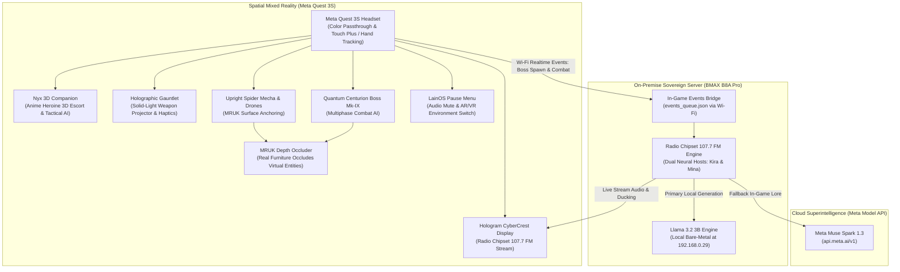

# 🌐 Project Yui: The Wired Nexus & Radio Chipset 107.7 FM
> **Meta Global AI Developer Hackathon 2026**  
> **Track:** Indie Developer Track ($150,000) & Creative Superintelligence ($5,000)  
> **Author:** Raquel D. Torres (*El taller de la gatita tech*)  
> **Target Hardware:** Meta Quest 3S / Quest 3 + On-Premise Sovereign Server BMAX B8A Pro  
> **Engine:** Unity 6 LTS (6000.6.5f1) + Universal Render Pipeline (URP)  
> **AI Models:** Meta Llama 3.2 3B (Bare-metal on-premise via Ollama) + Meta Muse Spark 1.3 (`https://api.meta.ai/v1`)  

[](https://www.meta.com/quest/quest-3s/)
[](https://unity.com/)
[](https://llama.meta.com/)
[](LICENSE)

---

## 📽️ Video Demonstration (3 Minutes)
[](https://youtube.com)  
*(Full gameplay in physical room passthrough, 3D anime companion Nyx, combat against upright spider mechas and the Quantum Centurion boss, live Radio Chipset 107.7 FM streaming, and interactive LainOS pause menu).*

---

## 📜 Prior Work & Hackathon Contribution Disclosure
*In strict accordance with the Meta Global AI Developer Hackathon guidelines regarding pre-existing foundations and submission deadlines:*

### Pre-Existing Foundation (Built Prior to Hackathon):
- **Core Desktop Companion Prototype (`cyber_companion`):** A pre-existing desktop PyQt/PySide experiment with conversational loops and basic hardware telemetry.
- **Physical Server Deployment:** Pre-configured bare-metal Debian 12 (LGM-OS 3.15.1) on the BMAX B8A Pro mini PC.

### New Contributions (100% Developed During the Hackathon: Oct 26 – Nov 4, 2026):
1. **Full Unity 6 Mixed Reality Stack (`quest_mr_nexus/`):**
   - **Solid-Light Weapon Projector** (`HolographicGauntlet.cs`) with haptic profiles for Meta Touch Plus and optical hand tracking (`XRHandAnchorFollower.cs`).
   - **Full 3D Anime Heroine Companion Nyx** (`Nyx_Companion_Anime3D.fbx` + `NyxFloatingCompanion.cs`): 0.55m tactical scale, crimson hair, smooth flank hover escort, procedural hovering animations, and combat-reactive voice dialogue.
   - **3D Combat Enemies & Bosses:**
     - **Upright Mecha Spider Drone AI** (`SpiderDrone_Mecha_3D.fbx` + `NeoCyberSpiderDroneAI.cs`): Upright crawling and wall-walking AI targeting physical surfaces (`WALL_FACE` and `FLOOR`) with plasma energy projectiles.
     - **Quantum Centurion Boss Mk-IX** (`QuantumCenturion_Boss_3D.fbx` + `QuantumCenturionBossAI.cs`): Bipedal armored mecha boss featuring multi-phase attack patterns, plasma blade cleaves, defensive energy shields, and heavy barrages.
   - **Live Radio Chipset 107.7 FM Streaming** (`HologramCyberCrestDisplay.cs`): Holographic 16:9 quad display embedding live YouTube stream (`https://www.youtube.com/embed/j_bLVMldHsA`) with real-time audio ducking.
   - **Interactive LainOS Cyberpunk Pause Menu** (`PauseMenuController.cs`): In-game cyberpunk menu with local audio mute toggle (`[M]`), instant AR/VR environment switching, resume, and exit options.
   - **Strict AR / VR Environment Isolation** (`CyberRoomDecorator3D.cs`): Clean separation between physical room passthrough and the fully immersive NeoEclipse Cyberspace Boulevard, with runtime Scene permission automation (`requestScenePermissionOnStartup: 1`).
   - **Real-World Spatial Occlusion System** (`MRUKOcclusionSetup.cs` + `MRUK_DepthMaskOccluder.shader`): Utilizing Meta Mixed Reality Utility Kit (MRUK) so real physical furniture (couches, tables, screens) physically occludes virtual enemies at 90 FPS.
2. **Autonomous Pirate Radio Station (`radio_chipset_broadcast/`):**
   - 24/7 dual neural DJ broadcast engine (*Kira & Mina*) featuring real-time audio ducking over Suno AI soundtrack compositions.
   - Real-time Wi-Fi event bridge (`events_bridge.py`) listening for Quest 3S combat achievements and status updates.
   - Multi-provider AI fallback client supporting on-premise Meta Llama 3.2 3B and cloud Meta Muse Spark 1.3 (`api.meta.ai/v1`).
3. **100% Symmetrical Bilingual Codebase (ES / EN) & Zero-Secrets Architecture:**
   - 48 C# scripts and Python tools fully commented and documented in Spanish and English.
   - Strict security shielding: comprehensive gitignore, zero hardcoded credentials, and isolated .env configurations.

---

## 🏛️ System Architecture



---

## 🎮 Key Features & Innovations

### 1. Interactive 3D Anime Companion (Nyx)
Nyx escorts the player at tactical scale (0.55m), floating smoothly at their left flank. She features crimson hair, optimized mobile shaders without texture memory overhead, and provides real-time tactical commentary based on battle conditions.

### 2. True Spatial Occlusion & 3D Upright Combat (MRUK)
Mecha spider drones crawl in an upright, stable posture along physical walls (`WALL_FACE`) and floors scanned with MRUK. When moving behind a real physical couch or monitor, the invisible depth mask ensures physical objects realistically occlude virtual entities at rock-solid 90 FPS.

### 3. Live Radio Chipset 107.7 FM Broadcast
Directly integrated into the 16:9 quad holographic display (`Hologram_CyberCrest_Display`), streaming Radio Chipset 107.7 FM with dynamic audio ducking whenever host dialogue or combat encounters occur.

### 4. LainOS In-Game Pause Menu with Audio & Mode Controls
Pressing `[M]` or the pause menu trigger allows players to mute local ambient environmental audio while keeping the Radio Chipset 107.7 FM stream alive, as well as seamlessly toggling between physical room Passthrough and the VR Cyberspace Boulevard.

### 5. Sovereign On-Premise Resilience
Zero cloud lock-in. Real-time combat responses and radio interactions are processed locally on the homelab cluster via open-weight Meta Llama 3.2 3B, ensuring complete operational autonomy.

---

## 🚀 Quickstart & Setup Guide

### Running the Unity Mixed Reality Project (Meta Quest 3S)
1. Open Unity Hub and add `quest_mr_nexus/` using **Unity 6 LTS (6000.6.5f1)**.
2. Ensure **Universal Render Pipeline (URP)** and **Meta XR All-In-One SDK** are enabled.
3. Open `Assets/MainMRScene.unity`.
4. Connect the Meta Quest 3S via USB-C or Link and select **Build & Run** targeting Android.

### Running the 24/7 Pirate Radio Engine
```bash
cd radio_chipset_broadcast
pip install -r requirements.txt
python launcher.py --test        # Runs an immediate audio test with ducking
python launcher.py --continuous  # Launches the continuous 24/7 broadcast loop
```

---

## 👥 Authors & Acknowledgments
- **Lead Developer & Architect:** Raquel D. Torres (*El taller de la gatita tech*)
- **Built for:** The Meta Global AI Developer Hackathon (October 26 – November 4, 2026).
- **Special Thanks:** Meta Superintelligence Labs & Cerebral Valley for the Meta XR SDK and Muse Model API access.
