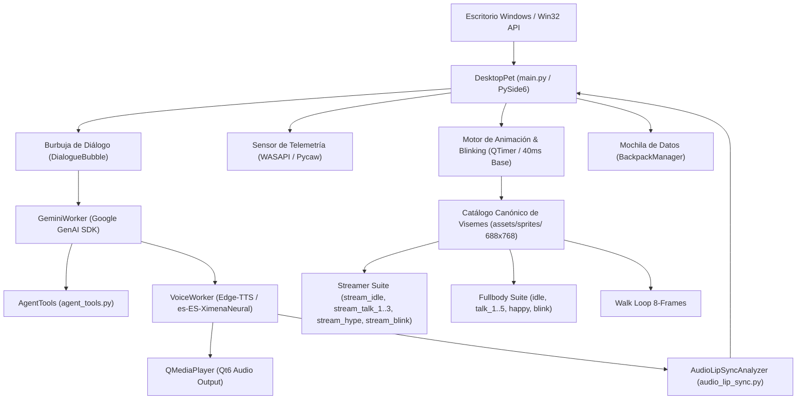

# ⚡ CyberCompanion (Rebeca 2D Live) // Sistema y Arquitectura Operativa

-41CD52?style=for-the-badge&logo=qt&logoColor=white)


> **Asistente táctica cibernética de escritorio 2D Live** con voz neural, visión artificial y capacidades agénticas. Inspirada en los universos de *Serial Experiments Lain*, *Ghost in the Shell*, *Cyberpunk 2077* y *Metal Gear Solid*.  
> Diseñada, calibrada y documentada en **El taller de la gatita tech** por **Raquel D. Torres**.

---

## 🧭 1. DESCRIPCIÓN DEL SISTEMA

**CyberCompanion** es una asistente de inteligencia artificial que reside de forma no intrusiva en el escritorio de Windows sobre una superficie transparente sin marcos. No es una simple animación decorativa ni un bot web convencional: combina **modelos fundacionales multimodales de Google AI Studio**, **síntesis de voz neural en tiempo real**, **telemetría sensorial de hardware (WASAPI / Win32)**, **motor DSP de Lip-Sync fonético y acústico frame a frame** y un **motor de animación 2D nativo en Qt6/PySide6** que consume **0.0% de CPU en reposo**.

### 🌟 Capacidades Principales:
* **Copiloto de Trinchera:** Asistencia en programación (Python, Kotlin, Java, Bash), hacking ético defensivo y administración de sistemas.
* **Motor DSP de Lip-Sync de Estudio (`audio_lip_sync.py`):** Decodificación nativa de MP3 con `QAudioDecoder` a PCM crudo en milisegundos. Aplica curvas de envolvente RMS, Zero-Crossing Rate (ZCR) para consonantes sibilantes vs. vocales abiertas, ataque instantáneo (10ms), histeresis vocal anime (80-120ms entre sílabas) y *Clean Silence Snap* (cierre estricto a reposo durante comas, pausas y puntos reales).
* **Parpadeo Biológico Orgánico:** Distribución biológica Poisson (2.8s - 5.5s) con probabilidad de micro-doble parpadeo rápido (600-1000ms) y duración natural de cierre palpebral de 140ms (`stream_blink.png` en streamer / `blink.png` en cuerpo entero).
* **Teleprompter en Vivo con HUD Transparente:** Ventana persistente no bloqueante para retransmisiones en OBS Studio y TikTok. Soporta envío rápido con `Intro` sin cerrar ventana, `Shift+Intro` para párrafos, selector dinámico de opacidad (100%, 85%, 70%, 55%, 40%) y auto-ocultación de la barra de escritorio durante la emisión.
* **Modo Plató OBS y Copresentadora (Zero-Jitter Desk):** Suite Streamer masterizada (`stream_idle`, `stream_talk_1..3`, `stream_hype`, `stream_blink`), anclaje milimétrico del plano de escritorio a $Y=767$ para estabilidad absoluta en cámara virtual y bloqueo automático de vaivén de respiración en plató.
* **Biomecánica de Caminata 2D I2V:** Ciclo de caminata de 8 fotogramas estabilizado con inercia de cabello y zancada natural a 120 ms por paso.
* **Mochila Cognitiva y Memoria Persistente:** Interfaz gráfica para cargar biografías y documentos `.docx` del usuario para contextualizar las respuestas de Gemini.
* **Telemetría Inteligente sin Falsos Positivos:** Detección de música y películas mediante medición de pico real de volumen (`IAudioMeterInformation.GetPeakValue() > 0.005`), inmune a sesiones silentes de OBS Studio o Discord.
* **Herramientas Agénticas Físicas & Red de Seguridad:** Control de aplicaciones locales, gestión de calendario universal `.ics` (RFC 5545), consulta de clima satelital (Open-Meteo), apertura reforzada multi-capa en navegador de Windows (`webbrowser`, `os.startfile`, `start`) y red de seguridad determinista ante consultas de búsqueda.
* **Pipeline de Audio Fail-Safe:** Generador de caché con timestamp dinámico rotativo, retención de los últimos 4 buffers, protección contra bloqueos de archivos en Windows y monitor nativo de fallos `QMediaPlayer.errorOccurred`.

---

## ⚙️ 2. ARQUITECTURA DE MÓDULOS TÉCNICOS



### 📁 Estructura del Repositorio:
* **`main.py`:** Núcleo de la aplicación, máquina de estados finitos (`PetState`), renderizado HiDPI, menús contextuales, temporizadores biológicos y lazos asíncronos.
* **`audio_lip_sync.py`:** Motor DSP de análisis fonético y acústico en tiempo real con decodificación MP3 por `QAudioDecoder`, histeresis vocal anime y mapeo a visemes de estudio.
* **`agent_tools.py`:** Catálogo de herramientas que Gemini puede invocar autónomamente (lanzar programas, crear eventos `.ics`, generar `.docx`, medir batería, consultar clima).
* **`backpack_manager.py`:** Gestor de memoria episódica, historial de chat y extracción de contexto de documentos subidos a `backpack/`.
* **`backpack_dialog.py`:** Diálogo flotante con estilo LainOS para subir y gestionar archivos de la mochila de datos.
* **`METODOLOGIA_MAESTRA_SPRITES_I2V.md`:** Manual exhaustivo sobre la generación de vídeo Image-to-Video, prompts maestros y extracción con visión artificial en Python.
* **`PROMPTS_MAESTROS_SPRITES.md`:** Catálogo de prompts de producción para nuevas animaciones.
* **`assets/sprites/`:** Bóveda de sprites transparentes recortados, des-verdecidos (*despilled*) y calibrados al suelo (`Y = 767`).
* **`iniciar_rebeca.vbs`:** Lanzador silencioso en segundo plano para Windows sin ventana negra de consola.
* **`iniciar_rebeca.bat`:** Lanzador de respaldo en consola para diagnóstico rápido.

---

## 📊 3. MATRIZ DE ESTADOS DEL SISTEMA (`PetState`)

| Estado | Sprite(s) Base Canónicos | FPS / Cadencia | Disparador / Comportamiento Táctico |
| :--- | :--- | :--- | :--- |
| **`IDLE`** | `idle.png` / `stream_idle.png` | 25 FPS (Respiración senoidal) | Reposo estándar en escritorio. Ojos abiertos; activa parpadeo biológico cada 2.8-5.5s. |
| **`BLINK`** | `blink.png` / `stream_blink.png` | Evento discreto (140 ms) | Parpadeo biológico orgánico (cierre palpebral realista en reposo y micro-doble parpadeo). |
| **`WALK`** | `walk_1.png` .. `walk_8.png` | 8.3 FPS (120 ms por paso) | Patrulla continua o paseo breve; física de zancada, balanceo capilar y rebote en bordes. |
| **`TALK`** | **DSP Lip-Sync Anime:**<br>• *Streamer:* `stream_idle`, `stream_talk_1` (entreabierta), `stream_talk_2` (redonda O), `stream_talk_3` (abierta A), `stream_hype`<br>• *Cuerpo Entero:* `idle`, `talk_1` .. `talk_5` | 25 FPS Frame-Accurate (40 ms por chunk) | Decodificación MP3 en milisegundos con `QAudioDecoder`, histeresis vocal anime (hold 80-120ms) y snap de silencio acústico. |
| **`THINK`** | **Dual:**<br>• *Cuerpo Entero:* `think.png`, `think_1.png`, `think_2.png` (Teclado y HUD holográfico flotante)<br>• *Streamer:* `stream_think.png`, `stream_think_1.png`, `stream_think_2.png` (Mesa, visor digital y teclado mecánico) | 6.25 FPS (160 ms por fase) | Modo Netrunner; consulta en curso a Gemini, invocación de herramientas o rastreo web. |
| **`SLEEP`** | `sleep.png` / `sleep_1.png` + badge `zZZ` neón | 25 FPS (Respiración profunda) | Inactividad del usuario tras 5 min (`GetLastInputInfo >= 300s`) o comando directo. Parpadeo suspendido. |
| **`MUSIC`** | `music.png`, `music_1.png`, `music_2.png` | Bucle dinámico (250 ms) + notas flotantes | Detección de audio audible real en Windows (`WASAPI Peak > 0.005`) sin pantalla completa. Bailando con auriculares. |
| **`MOVIE`** | `movie.png`, `movie_1.png` .. `movie_3.png` / `desk_movie.png` | Bucle dinámico (300 ms) + opacidad al 35% | Audio activo + reproductor o navegador en pantalla completa (VLC, YouTube, Netflix). Comiendo palomitas con gafas 3D. |
| **`LAUGH`** | `laugh.png` + modulación `smile_talk` / `stream_hype` | 12.5 FPS (80 ms) | Reacción a bromas, chistes o etiqueta contextual `[ESTADO: LAUGH]`. |
| **`HAPPY`** | `happy.png` + modulación `smile_talk` / `stream_hype` | 12.5 FPS (80 ms) | Celebración de éxitos, agradecimiento o etiqueta contextual `[ESTADO: HAPPY]`. |
| **`SURPRISE`**| `surprise.png` + badge de alerta táctica | 12.5 FPS (80 ms) | Asombro, alertas de sistema o etiqueta contextual `[ESTADO: SURPRISE]`. |
| **`POUT`** | `pout.png` + gota anime de sweat cómico | 25 FPS | Puchero cómico y modo ofendida cómplice ante vaciles del operador. |

---

## 🚀 4. PROTOCOLO DE DESPLIEGUE PASO A PASO

### Requisitos Previos:
* Windows 10 u 11 (64 bits).
* Python 3.11, 3.12 o 3.14 instalado en el sistema.
* Clave de API gratuita de [Google AI Studio](https://aistudio.google.com/).

### Instalación de Dependencias:
Abre PowerShell en la raíz del proyecto y ejecuta:
```powershell
pip install PySide6 google-genai edge-tts pycaw comtypes python-docx pillow rembg opencv-python
```

### Configuración Inicial:
1. Copia `config.example.json` a `config.json` si no existe:
```json
{
    "gemini_api_key": "TU_API_KEY_DE_GOOGLE_AI_STUDIO",
    "voice": "es-ES-XimenaNeural",
    "rate": "+5%",
    "pitch": "+0Hz",
    "scale": "normal",
    "studio_style": "normal"
}
```
2. También puedes ingresar la API Key directamente haciendo clic derecho sobre Rebeca ➔ **`🔑 Configurar Gemini API Key`**.

### Ejecución:
* **Modo Silencioso (Producción):** Haz doble clic en [`iniciar_rebeca.vbs`](file:///c:/Users/asakura/Documents/cyber_companion/iniciar_rebeca.vbs). Rebeca aparecerá en la esquina inferior derecha de tu pantalla sin terminales negras abiertas.
* **Modo Diagnóstico (Desarrollo):** Haz doble clic en [`iniciar_rebeca.bat`](file:///c:/Users/asakura/Documents/cyber_companion/iniciar_rebeca.bat).

---

## 🛡️ 5. AVISO ÉTICO Y DE SEGURIDAD DEFENSIVA

Este software ha sido concebido para investigación en interfaces cerebro-máquina (HCI), asistencia en desarrollo de software y experimentación ética en ciberseguridad.

* **Privacidad Primero:** Rebeca no transmite telemetría personal a servidores de terceros más allá de las llamadas directas que tú autorices a la API de Google Gemini y las solicitudes locales de síntesis de voz a Edge-TTS.
* **Entorno de Sandbox:** Los scripts y capacidades de automatización del sistema deben ser ejecutados en entornos de trabajo autorizados bajo supervisión del Operador.

---

## 📜 6. LICENCIA MIT

```text
MIT License

Copyright (c) 2026 Raquel D. Torres — El taller de la gatita tech

Permission is hereby granted, free of charge, to any person obtaining a copy
of this software and associated documentation files (the "Software"), to deal
in the Software without restriction, including without limitation the rights
to use, copy, modify, merge, publish, distribute, sublicense, and/or sell
copies of the Software, and to permit persons to whom the Software is
furnished to do so, subject to the following conditions:

The above copyright notice and this permission notice shall be included in all
copies or substantial portions of the Software.

THE SOFTWARE IS PROVIDED "AS IS", WITHOUT WARRANTY OF ANY KIND, EXPRESS OR
IMPLIED, INCLUDING BUT NOT LIMITED TO THE WARRANTIES OF MERCHANTABILITY,
FITNESS FOR A PARTICULAR PURPOSE AND NONINFRINGEMENT. IN NO EVENT SHALL THE
AUTHORS OR COPYRIGHT HOLDERS BE LIABLE FOR ANY CLAIM, DAMAGES OR OTHER
LIABILITY, WHETHER IN AN ACTION OF CONTRACT, TORT OR OTHERWISE, ARISING FROM,
OUT OF OR IN CONNECTION WITH THE SOFTWARE OR THE USE OR OTHER DEALINGS IN THE
SOFTWARE.
```
