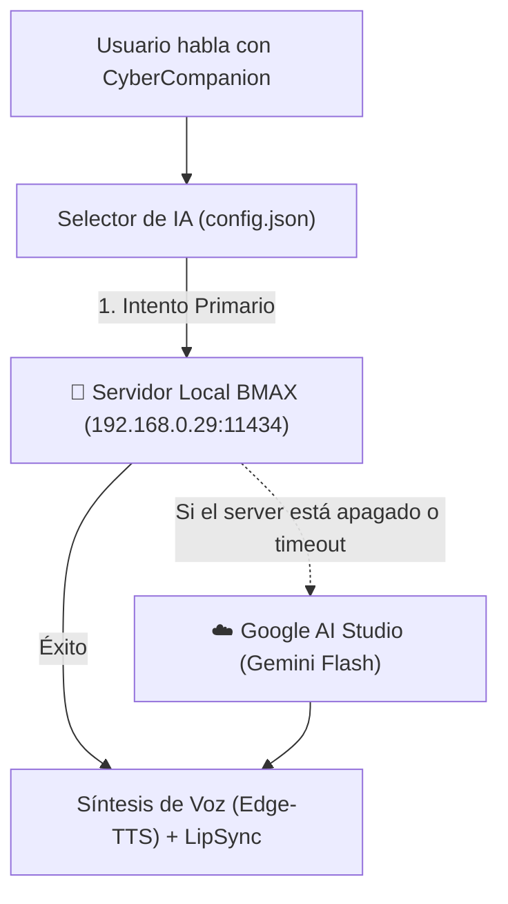

# 🚀 Conexión de CyberCompanion al Servidor Local (BMAX Homelab)
**Proyecto:** CyberCompanion (Rebeca 2D Live)  
**Entorno de Cómputo:** Servidor Homelab Dedicado (Mini PC BMAX B8A Pro)  
**Ubicación de Referencia:** `C:\Users\asakura\Documents\home lab\docs\DICCIONARIO_Y_GUIA_SERVIDOR_BMAX.md`

---

## 🎯 1. ¿Por qué este documento?

Actualmente, **CyberCompanion** utiliza la API gratuita de **Google AI Studio (Gemini)** para procesar los mensajes, las herramientas agénticas y el razonamiento del asistente.

Aunque la API de Google es rápida y potente, tiene limitaciones importantes:
* Cuotas y límites de peticiones por minuto (errores 429 de Rate Limit).
* Dependencia obligatoria de conexión a internet.
* Los datos de la *Mochila Cognitiva* y documentos del usuario viajan a la nube.

Desde el 26 de octubre de 2026, **El taller de la gatita tech cuenta con un servidor dedicado de Inteligencia Artificial en red local** corriendo sobre un AMD Ryzen 7 8745HS (Zen 4 con AVX-512) y 16 GB DDR5, capaz de procesar inferencia de IA en milisegundos sin consumir un solo ciclo de CPU ni memoria en el portátil de trabajo.

---

## 🌐 2. Coordenadas del Servidor de IA

| Parámetro | Valor Local | Notas |
| :--- | :--- | :--- |
| **IP del Servidor** | `192.168.0.29` | Hostname: `gatita-taller-server` |
| **Puerto del Motor Ollama** | `11434` | Escuchando en `0.0.0.0` (abierto a la red local) |
| **Endpoint Nativo Ollama** | `http://192.168.0.29:11434/api/chat` | Formato nativo JSON de Ollama |
| **Endpoint Compatible OpenAI** | `http://192.168.0.29:11434/v1` | Permite usar la librería estándar `openai` |
| **Modelos Instalados en el NVMe** | • `llama3.2:3b`<br>• `llama3.2:1b` | Modelos oficiales de Meta AI listos para inferencia |

---

## 🧠 3. Modelos Locales Disponibles para Rebeca / Yui

1. **`llama3.2:3b` (Recomendado para CyberCompanion):**
   * **Tamaño:** ~2.0 GB.
   * **Rendimiento:** ~13 a 25 tokens/segundo en el silicio del BMAX.
   * **Fortalezas:** Excelente seguimiento de personalidad cyberpunk/táctica, capacidad de razonamiento agéntico y llamadas a herramientas locales (*Function Calling*).
2. **`llama3.2:1b` (Modo Ultra-Baja Latencia):**
   * **Tamaño:** ~1.3 GB.
   * **Fortalezas:** Respuestas casi instantáneas en menos de 1 segundo; ideal para comandos de voz rápidos o respuestas cortas.

---

## 🔌 4. Arquitectura de Doble Motor (Híbrida con Fallback)

Cuando decidamos integrar el servidor local en `main.py` o `agent_tools.py`, la mejor estrategia no es sustituir a Google a ciegas, sino aplicar un **sistema de conmutación inteligente**:



---

## 💻 5. Ejemplo de Código para Integración Futura

### Opción A: Usando la librería estándar `openai` (Recomendado)
Instalando `openai` (`pip install openai`), podemos hablar con el servidor local sin tocar apenas la lógica existente:

```python
from openai import OpenAI

# Cliente apuntando directamente a nuestro BMAX
client = OpenAI(
    base_url="http://192.168.0.29:11434/v1",
    api_key="ollama"  # Ollama local no requiere clave, pero el cliente pide un texto
)

def consultar_servidor_local(prompt_usuario, system_prompt):
    try:
        response = client.chat.completions.create(
            model="llama3.2:3b",
            messages=[
                {"role": "system", "content": system_prompt},
                {"role": "user", "content": prompt_usuario}
            ],
            temperature=0.7,
            timeout=10.0  # Si el servidor no responde en 10s, saltar al fallback
        )
        return response.choices[0].message.content
    except Exception as e:
        print(f"[!] Servidor local inaccesible ({e}). Conmutando a Google Gemini...")
        return None  # Señal para activar el motor de Google AI Studio
```

### Opción B: Usando `requests` puro (Cero dependencias nuevas)
```python
import requests

def consultar_ollama_raw(prompt_usuario, system_prompt):
    url = "http://192.168.0.29:11434/api/chat"
    payload = {
        "model": "llama3.2:3b",
        "messages": [
            {"role": "system", "content": system_prompt},
            {"role": "user", "content": prompt_usuario}
        ],
        "stream": False
    }
    resp = requests.post(url, json=payload, timeout=8.0)
    if resp.status_code == 200:
        return resp.json()["message"]["content"]
    return None
```

---

## 📝 6. Registro de Cambios Previsto en `config.json`
Cuando vayamos a activar el soporte local en CyberCompanion, bastará con añadir estas claves a `config.json` sin romper la compatibilidad actual:

```json
{
  "ai_backend": "local_first",
  "local_ollama_host": "http://192.168.0.29:11434",
  "local_model": "llama3.2:3b",
  "fallback_to_gemini": true
}
```

> 📌 **Nota de Taller:** Mientras tanto, el archivo original `README.md` y todo el código de `cyber_companion` se mantienen **100% intactos y funcionando con Google AI Studio**. Este archivo sirve de faro técnico para cuando queramos dar el salto a la arquitectura híbrida.
