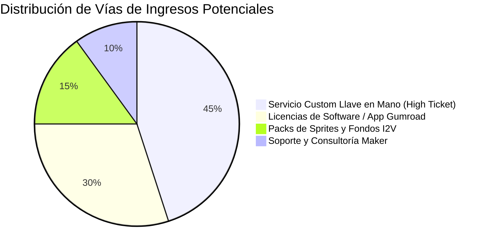
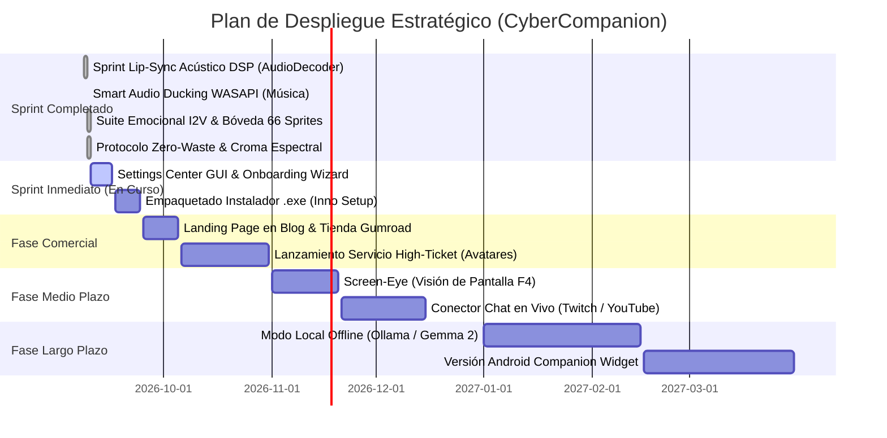

# 🗺️ HOJA DE RUTA & MODELO DE PRODUCTO // CyberCompanion (Rebeca 2D Live)
> **El taller de la gatita tech** | Arquitectura y Dirección Estratégica: **Raquel D. Torres**  
> *Fecha de corte:* Septiembre 2026 | *Versión del Núcleo:* v1.1.0 Multi-State Studio & Emotional Engine

---

## 🧭 1. ESTADO DE SITUACIÓN: ¿DÓNDE ESTAMOS HOY?

El proyecto ha consolidado la versión **v1.1.0 Multi-State Studio & Emotional Engine**, alcanzando la madurez completa de animación 2D y reactividad emocional con **66 sprites canónicos en bóveda**, **11 estados finitos biológicos y tácticos**, resolución dinámica de vestuario/plató (`streamer`, `reportera`, `telediario`, `compañera`), **bucles multi-fotograma en tiempo real**, **estabilidad total de consumo cero (0.0% CPU en reposo)**, **sincronización labial fonética y acústica (DSP Lip-Sync Anime)**, **Smart Audio Ducking WASAPI** y el **Protocolo Zero-Waste** de generación I2V.

```mermaid
journey
    title Trayectoria del Desarrollo de CyberCompanion
    section Fase 1: Génesis
      Núcleo PySide6 transparente: 5: Operador
      Conexión básica Gemini: 4: Operador
    section Fase 2: Robustez
      Sensor WASAPI audio real: 5: Operador
      Mochila documental y memoria: 5: Operador
    section Fase 3: Estudio & Sprites
      Pipeline I2V para Walk y Talk: 5: Operador
      Cámara virtual OBS y Fondos: 5: Operador
      Estabilización de mesa (Respiración): 5: Operador
      Teleprompter HUD Transparente: 5: Operador
    section Fase 4: Sincronización & Audio
      Sprint Lip-Sync Acústico DSP (AudioDecoder): 5: Operador
      Smart Audio Ducking WASAPI (Música): 5: Operador
      Parpadeo Biológico Orgánico: 5: Operador
    section Fase 5: Suite Emocional Completa (v1.1.0)
      Lote 25 vídeos I2V (66 sprites bóveda): 5: Operador
      11 Estados PetState + Bucles Animados: 5: Operador
      Segregación THINK vs STREAM_THINK: 5: Operador
      Croma Espectral Blindaje Neón (#00ffcc): 5: Operador
      Protocolo Zero-Waste (Screen Test Reel): 5: Operador
      Triple Protocolo Auditoría (100% OK): 5: Operador
    section Fase 6: Comercialización
      Onboarding guiado LainOS & Settings: 2: En curso
      Empaquetado Instalador (.exe): 2: En cola
      Lanzamiento comercial Gumroad: 1: En cola
      Servicio Avatar High-Ticket: 1: En cola
```

### ✅ Hitos Clave Completados (Assets en Producción v1.1.0 Multi-State Studio):
1. **Bóveda de Sprites & Suite Emocional Completa (66 Sprites Canónicos):**
   - **11 Estados en `PetState`:** `IDLE`, `TALK`, `WALK`, `THINK`, `SLEEP`, `MUSIC`, `MOVIE`, `LAUGH`, `HAPPY`, `SURPRISE`, `POUT`.
   - **Bucles Multi-Fotograma:** Animaciones vivas y cíclicas en `MOVIE` (`movie_1..3.png` comiendo palomitas con gafas 3D), `MUSIC` (`music_1..2.png` bailando con auriculares), `THINK` (`think_1..2.png` tecleando en teclado holográfico flotante) y `STREAM_THINK` (`stream_think_1..2.png` tecleando en teclado mecánico con visor digital).
   - **Segregación Rigurosa de Identidades:** Compañera de cuerpo completo (`think.png`, $Y=767$) totalmente desacoplada del plató streamer con mesa y micrófono boom (`stream_think.png`).
   - **Alineación y Geometría Canónica de Mesa:** Calibración milimétrica a $Y=767$ y ancho de mesa estandarizado ($W=417\text{ px}$) en todas las variantes de plató (`desk_movie.png`, `stream_idle.png`, `stream_talk_1..3.png`), garantizando cero temblor (*zero-jitter*) en cámara virtual de OBS Studio.
   - **Croma Clave Espectral Calibrado:** Algoritmo en ventana espectral $H \in [50, 75], S \ge 110, V \ge 100$ con despill exclusivo perimetral. Cero perforaciones (*zero alpha holes*) en circuitos neón cian (`#00ffcc`), texto del visor holográfico o carcasas de micrófono.
   - **Protocolo Zero-Waste (Screen Test Reel):** Técnica de secuenciación de 3-4 expresiones por clip de vídeo que reduce el gasto de créditos IA del cliente entre un 60% y un 75%.
2. **Motor Gráfico & Renderizado:**
   - Superficie transparente `Qt6` sin bordes y acelerada por hardware.
   - **0.0% de CPU en reposo** y huella de memoria ultraligera (~65 MB RAM).
   - Animación de caminata 2D I2V de 8 fotogramas estabilizada al suelo a 120 ms por paso.
   - **Motor DSP de Lip-Sync de Estudio (`audio_lip_sync.py`):** Decodificación nativa de MP3 con `QAudioDecoder` a PCM en milisegundos sin dependencias externas. Envolvente RMS, Zero-Crossing Rate (ZCR) para consonantes sibilantes vs. vocales abiertas, histeresis vocal anime (hold 80-120ms) y snap de silencio acústico inmediato.
   - **Parpadeo Biológico Orgánico:** Distribución biológica Poisson (2.8s - 5.5s) con micro-doble parpadeo rápido (600-1000ms) y duración natural de 140ms (`stream_blink.png` / `blink.png`).
3. **Plató Streamer (OBS Studio & TikTok Live):**
   - Suite Streamer masterizada (`stream_idle`, `stream_talk_1..3`, `stream_hype`, `stream_blink`, `stream_think_1..2`, `desk_movie`), con anclaje a $Y = 767$.
   - Trajes temáticos especializados (`streamer`, `reportera`, `telediario`, `compañera`).
   - Fondos panorámicos 16:9 generados con estética cyberpunk/estudio sin duplicidad de mobiliario.
   - Bloqueo de vaivén de respiración procedural (`is_studio`) para mantener la mesa y micrófono 100% fijos en cámara virtual.
   - **Teleprompter HUD Transparente:** Ventana flotante no modal con selector dinámico de opacidad (100%, 85%, 70%, 55%, 40%), envío con `Intro` continuo sin cierre, `Shift+Intro` para saltos de línea y auto-ocultación de la barra de escritorio durante la emisión.
   - Modo Eco OBS: repetidora de voz limpia con registro instantáneo en el chat persistente.
4. **Acústica & Smart Audio Ducking WASAPI:**
   - Atenuación cinematográfica al 20% con rampa *fade-out* (150ms) al activarse el micrófono o hablar Rebeca.
   - Restauración suave *fade-in* (350ms) a los volúmenes originales independientes de cada aplicación (Spotify, YouTube, VLC).
   - Inmunidad acústica total para OBS Studio, Discord y servicios del sistema.
5. **Cerebro Cognitivo & Sensorial:**
   - Enlace neural con Google Gemini (GenAI SDK) con streaming y timeout de protección (25s).
   - Memoria episódica persistente y mochila de documentos (`.docx`, `.txt`) para contexto biográfico y técnico del operador.
   - Detección acústica WASAPI por picos de volumen real (`Peak > 0.005`), inmune a falsos positivos de OBS Studio o Discord silentes.
   - Herramientas agénticas nativas: eventos `.ics` RFC 5545, clima satelital Open-Meteo, telemetría de batería y notas `.docx`.
   - **Red de Seguridad Agéntica Determinista:** Detección automática del navegador por defecto en Windows (`ChromeHTML` -> Google Chrome), apertura reforzada tri-capa e intercepción inmediata en `on_gemini_success`.
6. **Pipeline de Audio Fail-Safe:**
   - Generación de archivos MP3 en caché con marca de tiempo rotativa (`speech_cache_<timestamp>.mp3`), eliminando errores de archivo bloqueado en Windows (`WinError 32`).
   - Poda automática manteniendo los 4 buffers más recientes.
   - Monitor de eventos `QMediaPlayer.errorOccurred` para recuperar la animación de `TALK` a `IDLE`.
7. **Auditoría Triple & Respaldo Golden Master:**
   - Script de certificación `triple_verification_protocol.py` superado al 100% (pasada estructural, lógica DSP e interacción en vivo).
   - Copia de seguridad maestra comprimida: `backup_cyber_companion_golden_master_2026-09-09.zip` (89.26 MB).
   - Plantilla completamente desacoplada y anónima (`cyber_companion_template`).

---

## 🛍️ 2. ¿QUÉ PUEDE ESPERAR EL CLIENTE DEL SERVICIO?

El valor del servicio no radica en vender "otro chatbot de suscripción", sino en ofrecer una **presencia digital viva, autónoma y personalizada de escritorio**:

### A. Para Creadores de Contenido y Streamers (Twitch / YouTube / TikTok):
* **Copresentadora Virtual Inmediata:** Disponer de una co-host animada en OBS con su propia mesa, micrófono y auriculares sin necesidad de un ordenador secundario ni software de captura pesado tipo VTuber Studio.
* **Locución de Guiones en Vivo (Teleprompter HUD):** Pegar guiones o resúmenes en el teleprompter translúcido sobre el juego o aplicación y hacer que la copresentadora los relate con voz neural natural y lip-sync para directos, clips y reels.
* **Escenografía Completa:** Fondos temáticos listos para encajar como cámara virtual o capa de streaming.

### B. Para Desarrolladores, Makers e Investigadores:
* **Compañera de Trinchera No Invasiva:** Reside en la esquina de la pantalla sin estorbar, lista para resolver dudas de código, consultar documentación en segundo plano o recordar tareas.
* **Reconocimiento de Entorno Sensorial:** Sabe cuándo estás escuchando música, cuándo estás viendo una película a pantalla completa (bajando su opacidad al 35% para no tapar subtítulos) y cuándo te ausentas del teclado para ponerse a dormir.
* **Soberanía y Privacidad:** Modelo *Bring Your Own Key* (BYOK). El cliente es dueño de sus datos y de su cuenta de Google AI Studio; nada pasa por servidores intermediarios ocultos.

### C. Para Usuarios Particulares / Teletrabajadores:
* **Interacción Natural Multimodal:** Control por voz libre de manos (F3), atajo rápido (F2) o teclado con doble clic.
* **Memoria y Acompañamiento:** Una IA que te conoce a través de tu mochila de datos y que no olvida quién eres de una sesión a otra.

---

## 💰 3. ANÁLISIS DE RENTABILIDAD & MONETIZACIÓN

### ¿En qué punto estamos de ser rentables?
**Estamos al 90% de preparación técnica para el lanzamiento comercial.**  
La arquitectura actual posee una ventaja económica aplastante: **Coste Operativo Cero (Margen de beneficio > 95%)**.  
Al delegar la API a Google AI Studio (modelo BYOK) y la síntesis vocal a Edge-TTS local, **tú como proveedora no pagas servidores de inferencia, bases de datos en la nube ni cuotas mensuales recurrentes por cada usuario activo.**



### Modelos de Monetización Viables:

| Vía de Negocio | Público Objetivo | Precio Estimado | Esfuerzo de Entrega | Margen |
| :--- | :--- | :--- | :--- | :---: |
| **1. Pack Software Listo para Usar (Gumroad / Itch.io)** | Devs, techies, fans del anime/cyberpunk | **19€ – 29€** (pago único) | Automatizado (Descarga del instalador `.exe`) | **~97%** |
| **2. Servicio Llave en Mano "Tu Avatar IA" (High Ticket)** | Streamers, podcasters, marcas personales | **250€ – 750€** (por encargo) | Creamos sus sprites con su imagen, su fondo OBS y su personalidad | **~90%** |
| **3. Bóveda de Expansión de Sprites & Fondos** | Clientes existentes del software | **9€ – 15€** por pack temático | Muy bajo (generación I2V a 15 créditos/vídeo) | **~98%** |
| **4. Versión Pro / Conector de Directos (Twitch / Kick)** | Streamers profesionales | **49€** o **5€/mes** | Medio (lectura de chat y donaciones) | **~95%** |

---

## 🧩 4. ¿QUÉ NOS FALTA POR AGREGAR? (BRECHAS TÉCNICAS HACIA LA V1.0)

Para que el cliente final pueda comprar e instalar CyberCompanion sin requerir asistencia técnica de terminal, se han definido las siguientes metas de desarrollo:

### 🎙️ 4.1. Sprint de Sincronización Labial Avanzada (Lip-Sync Realista por Amplitud y Fonemas) — [✅ COMPLETADO AL 100% EN V1.0.0]
> **Estado en Producción (Septiembre 2026):** Implementado y verificado al 100% en `audio_lip_sync.py` y `main.py`. Cuenta con decodificación local por `QAudioDecoder`, histeresis vocal anime (hold 80-120ms entre sílabas) y *Clean Silence Snap* para cerrar la boca inmediatamente durante silencios, pausas y comas.

#### Arquitectura Operativa Implementada (Dual: Escritorio + Plató OBS):
1. **Medición de Energía y Amplitud en Tiempo Real (RMS & ZCR Audio Metering):**
   - El analizador `AudioLipSyncAnalyzer` decodifica los archivos MP3 generados por Edge-TTS directamente a PCM en milisegundos sin dependencias externas pesadas.
   - Calcula la envolvente RMS por chunk de 40ms (25 FPS) y la tasa de cruces por cero (Zero-Crossing Rate) para separar consonantes sibilantes de vocales abiertas.
   - Cuando el valor RMS cae por debajo del umbral de silencio (`RMS < 0.035`) durante más de 120ms, el sprite conmuta automáticamente a reposo:
     - **En Modo Normal:** Conmuta a `idle.png` (o `talk_1.png` entreabierta en micro-pausas sintácticas).
     - **En Modo Stream Talk (Plató OBS):** Conmuta a `stream_idle.png` (cerrando la boca frente al micrófono de estudio).
2. **Mapeo Fonético y Dinámica de Visemas según el Modo Activo:**
   - **A. Modo Escritorio Fullbody:**
     - *Silencio:* `idle.png` (boca cerrada).
     - *Baja energía (consonantes / inicio de fonación):* `talk_1.png` y `talk_4.png`.
     - *Energía media (articulación de vocales medias):* `talk_2.png`.
     - *Alta energía / acentos tónicos (vocales A, O, énfasis):* `talk_3.png` y `talk_5.png`.
   - **B. Modo Stream Talk / Plató Presentadora (Familia `stream_talk`):**
     - *Silencio:* `stream_idle.png` (boca cerrada, atenta a la cámara y al chat).
     - *Baja energía / consonante:* `stream_talk_1.png` (apertura sutil ante el micro de estudio).
     - *Energía media (redonda 'O' / 'U'):* `stream_talk_2.png` (modulación fonética estándar).
     - *Alta energía / exclamación:* `stream_talk_3.png` (máxima apertura de locución).
     - *Reacción a donaciones o clímax:* `stream_hype.png`.
     - *Parpadeo en plató:* `stream_blink.png`.
3. **Estabilidad Absoluta en Cámara Virtual (Zero-Jitter Desk):**
   - El plano de la mesa mecánica, boom del micrófono y teclado permanece fijado milimétricamente en $Y=767$ en el lienzo de 688x768.
   - Se elimina cualquier temblor o salto en OBS Studio durante la articulación labial de Rebeca.

---

### 🔉 4.2. Módulo de Atenuación Acústica Automática del Sistema (Smart Audio Ducking WASAPI) — [✅ COMPLETADO AL 100% EN V1.0.0]
> **Estado en Producción (Septiembre 2026):** Implementado y verificado en `audio_ducking.py` y `main.py`. Integra control de sesiones WASAPI vía `pycaw`, atenuación cinematográfica al 20% con rampa fade-out (150ms), restauración gradual fade-in (350ms), e inmunidad total para OBS Studio, Discord y servicios del sistema.

#### Arquitectura Técnica del Ducking (Control de Sesiones de Audio en Windows):
1. **Integración Nativa con Windows Core Audio API (`pycaw`):**
   - Reutilizar la infraestructura de `pycaw.AudioUtilities.GetAllSessions()` ya presente en el motor para enumerar en tiempo real las sesiones de reproducción de audio activas (Spotify, Google Chrome, Edge, VLC, reproductores multimedia).
   - Acceso directo a la interfaz COM `ISimpleAudioVolume` para modular el volumen individual por proceso sin necesidad de tocar el volumen maestro global del hardware de Windows.
2. **Disparo Bidireccional de Atenuación:**
   - **En Recepción de Órdenes (Push-to-Talk F2 / Manos Libres F3):** Al activar el micrófono, la música de fondo se atenúa instantáneamente (ej. al 15% - 20%) para que el receptor de voz capture las órdenes del operador nítidas, reduciendo a cero las alucinaciones por eco o música colada en el micro.
   - **En Locución Activa de Rebeca (`PetState.TALK` / `play_voice`):** Durante la reproducción de la respuesta de Rebeca, el volumen atenuado se mantiene firme para que el operador escuche su voz clara y en primer plano.
3. **Curvas de Transición Orgánica (Rampas Fade-Out & Fade-In):**
   - **Atenuación Suave (*Fade-Out*):** Rampa rápida de descenso de ~150 ms para evitar cortes acústicos secos o chasquidos.
   - **Restauración Gradual (*Fade-In*):** Al finalizar la locución (`on_audio_state_changed` -> `StoppedState`), se aplica una rampa ascendente suave de ~350 ms para devolver la música a su volumen inicial.
4. **Persistencia de Niveles Originales y Tolerancia a Fallos:**
   - Registro en memoria de un diccionario `{session_id: original_volume}` para que cada aplicación (Spotify al 50%, Chrome al 80%) recupere con exactitud su volumen específico previo.
   - Exclusión estricta de la propia voz de Rebeca (`python.exe` / `pythonw.exe`) y software de streaming/comunicaciones esenciales (`obs64.exe`, `discord.exe`).
   - Mecanismo de seguridad (*Fail-Safe*): Si se pulsa ESC o se produce un cierre inesperado, un gancho de limpieza restaura de inmediato todas las sesiones a su nivel previo.

---

### 📦 4.3. Backlog de Producto y Distribución Comercial:
```
[ BACKLOG DE PRODUCTO // CYBERCOMPANION V1.1.0 MULTI-STATE STUDIO ]
├── 1. Sprint Lip-Sync Acústico Realista [✅ COMPLETADO 100% EN V1.0.0]
│   ├── Analizador RMS & ZCR de energía de audio en tiempo real (QAudioDecoder).
│   ├── Fast Attack (10ms) e histeresis vocal anime (hold 80-120ms).
│   ├── Cierre labial dinámico en pausas y silencios (Clean Silence Snap).
│   └── Parpadeo biológico orgánico (Poisson 2.8s-5.5s, 140ms cierre).
├── 2. Módulo de Atenuación Acústica Automática (Smart Audio Ducking WASAPI) [✅ COMPLETADO 100% EN V1.0.0]
│   ├── Detección de música activa y rampa de atenuación al recibir órdenes (F2/F3).
│   ├── Mantenimiento de volumen atenuado durante la locución de Rebeca.
│   ├── Rampa suave de recuperación (Fade-In) al volumen original de cada app.
│   └── Fail-safe de restauración en parada forzada (ESC) y cierre de ventana.
├── 3. Suite Emocional Completa & Bóveda de 66 Sprites I2V [✅ COMPLETADO 100% EN V1.1.0]
│   ├── 11 Estados PetState integrados y auditados (IDLE, TALK, WALK, THINK, SLEEP, MUSIC, MOVIE, LAUGH, HAPPY, SURPRISE, POUT).
│   ├── Segregación anatómica THINK (holograma) vs STREAM_THINK (plató OBS).
│   ├── Bucles multi-fotograma en tiempo real (MOVIE 1..3, MUSIC 1..2, THINK 1..2, STREAM_THINK 1..2).
│   ├── Croma clave espectral calibrado con blindaje neón cian (#00ffcc, cero agujeros alfa).
│   ├── Calibración métrica de mesa (W=417px, Y=767) en desk_movie y stream_idle.
│   ├── Protocolo Zero-Waste (Screen Test Reel) para ahorro de 75% de créditos en clientes.
│   └── Triple Protocolo de Auditoría superado al 100% (3/3 pasadas).
├── 4. Panel de Ajustes GUI Unificado (Settings Center LainOS) [🟡 EN CURSO / SPRINT ACTIVO]
│   ├── Panel centralizado con estética cian neón/oscura para sustituir micro-diálogos sueltos.
│   ├── Pestaña 1: Configuración de IA (API Key, modelo Gemini 2.5/Flash-Lite, temperatura).
│   ├── Pestaña 2: Voz y Acústica (Selector de voz neural, tono, velocidad, Ducking slider).
│   ├── Pestaña 3: Apariencia & Plató (Selector de vestuario: normal, streamer, reportera, telediario).
│   └── Pestaña 4: Mochila de Datos (Gestión de notas .docx, archivos biográficos del operador).
├── 5. Asistente de Configuración Inicial (Onboarding Wizard) [🟡 EN CURSO]
│   ├── Ventana GUI en primer arranque si no existe config.json.
│   ├── Enlace directo a Google AI Studio para obtención de API Key gratuita.
│   └── Verificación en vivo de conectividad antes de lanzar la mascota.
├── 6. Empaquetado Monolítico (.exe) & Distribución [🟢 SIGUIENTE SPRINT]
│   ├── Compilación optimizada PyInstaller / Nuitka sin consolas negras ni falsos positivos.
│   └── Instalador guiado Inno Setup (Next -> Next -> Finish).
├── 7. Visión Artificial Rápida (Screen-Eye F4) [🔮 MEDIO PLAZO]
│   ├── Atajo de teclado para capturar la pantalla activa o región de depuración.
│   └── Envío a Gemini Flash para análisis de código en VS Code, terminales o errores.
└── 8. Integración Básica con Streaming (Twitch/YouTube/TikTok Chat Listener) [🔮 MEDIO PLAZO]
    └── Módulo para lectura opcional de superchats, preguntas o alertas de directos.
```

---

## 🔮 5. VISTA FUTURA (CRONOGRAMA ESTRATÉGICO ACTUALIZADO)



### Horizonte Temporal Detallado:

### 🎯 Fase Inmediata (Próximos 7 – 14 días) — *Lip-Sync, Audio Ducking & Empaquetado Comercial*
- **Objetivo:** Perfeccionar la sincronización labial y la acústica del entorno, integrando atenuación automática de música y dejando el instalador listo para su comercialización.
- **Entregables:**
  - Módulo de sincronización labial realista (cierre de boca en silencios y apertura proporcional a la energía acústica).
  - **Módulo de Atenuación Acústica Automática (*Smart Audio Ducking*):** Bajada suave (fade-out) del volumen de Spotify, YouTube o reproductores al dar una orden (F2/F3) o durante la locución de Rebeca, con subida gradual (fade-in) a su nivel original al terminar.
  - Instalador ejecutable `.exe` autosuficiente empaquetado con PyInstaller e Inno Setup.
  - Asistente de bienvenida (*Onboarding GUI*) que solicita la API Key y guía al usuario novato.
  - Ficha de producto en Gumroad y artículo de trinchera en [El taller de la gatita tech](https://eltallerdelagatatech.blogspot.com/).

### 🚀 Fase Media (1 – 3 meses) — *Potenciación de Streaming & Visión*
- **Objetivo:** Consolidar a CyberCompanion como la herramienta definitiva de streaming y copilotaje de desarrollo.
- **Entregables:**
  - Módulo `Screen-Eye`: Rebeca ve tu código de VS Code, terminales o errores de compilación con una pulsación de tecla (F4).
  - Listener para chats de streaming en vivo (Twitch / YouTube / TikTok).
  - Apertura formal del servicio de avatares a medida para streamers y marcas (diseño de sprites temáticos, fondos OBS y prompts de personalidad).

### 🌌 Fase Larga (4 – 6 meses) — *Autonomía Soberana & Ecosistema Móvil*
- **Objetivo:** Independencia total de servidores externos y expansión multiplataforma.
- **Entregables:**
  - Motor de inferencia local opcional compatible con Ollama (Gemma 2 / Llama 3) para entornos sin conexión a internet.
  - Aplicación complementaria para Android con widget animado, notificaciones de calendario y sincronización remota.

---

## 💡 CONCLUSIÓN ESTRATÉGICA PARA LA MAYOR

Raquel, el motor de Rebeca se encuentra hoy en un **estado de excelencia técnica y solvencia indiscutible (v0.9.8 Golden RC)**. La combinación de Teleprompter HUD transparente, plató OBS con respiración estabilizada, telemetría de hardware no invasiva y red de seguridad agéntica determinista sitúan este software muy por encima de cualquier juguete comercial en el mercado.

El enfoque para las próximas sesiones está meridianamente claro:
1. **Perfeccionar el Lip-Sync** con análisis de amplitud acústica y silencios para un realismo cinematográfico.
2. **Empaquetar el instalador `.exe`** para que cualquier usuario pueda disfrutar de la experiencia a un solo clic.

*El taller de la gatita tech dispone de una tecnología robusta, visualmente cautivadora y con un margen de beneficio del 95%.*
