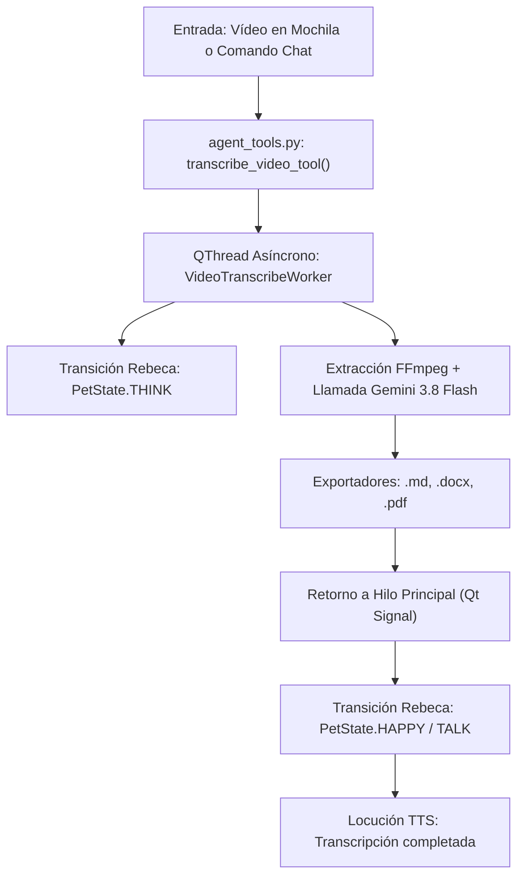

# 🗺️ HOJA DE RUTA: MÓDULO DE TRANSCRIPCIÓN DE VÍDEO // CyberCompanion
> **El taller de la gatita tech** | Dirección Estratégica: **Raquel D. Torres**  
> *Fecha de diseño:* Octubre 2026 | *Estado:* Módulo Desacoplado Listo -> Integración Agéntica en Cola

---

## 🧭 1. Visión y Objetivo de la Integración

Integrar la capacidad de transcripción universal de vídeo (extracción de audio + motor multimodal Gemini + exportación a `.md`, `.docx` y `.pdf`) directamente dentro del flujo de vida de **CyberCompanion (Rebeca 2D Live)**.

El objetivo es que Raquel pueda:
1. **Por Voz o Chat:** Decirle a Rebeca: *«Rebeca, transcríbeme el vídeo que tengo en Descargas y sácamelo en Word y PDF»*.
2. **Por Arrastre (Drag & Drop):** Soltar cualquier archivo de vídeo sobre la ventana de Rebeca o en su mochila (`backpack`), activando el procesamiento en segundo plano sin congelar la animación ni el habla.
3. **Feedback Multimodal:** Rebeca transiciona al estado `THINK` (animación tecleando con visor holográfico) mientras procesa, y al terminar transiciona a `HAPPY` anunciando por voz (TTS) que los documentos están listos.

---

## 🏗️ 2. Arquitectura de Integración Desacoplada



---

## 📋 3. Fases de Implementación en CyberCompanion

### Fase 1: Puente de Herramientas (`agent_tools.py`)
- Ubicar o referenciar el paquete `video_transcriber` en `tools/media_transcriber.py`.
- Registrar la herramienta agéntica en el catálogo del sistema (`agent_tools.py`):
  ```python
  def transcribe_video_media(video_path: str, formats: str = "all") -> str:
      """
      Transcribe un archivo de vídeo o audio con 100% de fidelidad usando Gemini
      y genera documentos en .md, .docx y .pdf.
      """
      # Ejecución delegada al Worker asíncrono
  ```
- Reutilización de `config.json`: Toma directamente `gemini_api_key` ya configurada en el companion.

### Fase 2: Control Asíncrono en GUI (`main.py` & `QThread`)
- **Regla Inviolable LainOS:** Prohibido bloquear el bucle principal de eventos de Qt.
- Crear un `VideoTranscribeWorker(QThread)` con señales:
  - `sig_progress = Signal(str)` -> Envía estado al log y al HUD de telemetría.
  - `sig_finished = Signal(dict)` -> Envía las rutas de los archivos exportados.
  - `sig_error = Signal(str)` -> Manejo de excepciones sin crasheo de la aplicación.

### Fase 3: Coreografía de Sprites y Locución Vocal
- **Al iniciar la tarea:** Rebeca pasa automáticamente a `stream_think` (si está en plató) o `think_1` (si está en modo compañera).
- **Al finalizar con éxito:**
  1. Suena un sonido sutil de confirmación HUD.
  2. Rebeca pasa a `happy` o `stream_talk`.
  3. El motor de voz Edge-TTS (`es-ES-XimenaNeural`) vocaliza:
     *«Listo, Raquel. Transcripción completada con éxito. Tienes el Word, el PDF y el Markdown preparados en tu carpeta de salida.»*
  4. Los archivos generados se catalogan automáticamente en la mochila (`backpack_manager.py`).

### Fase 4: Activación por la Mochila (`backpack_dialog.py`)
- Añadir en el diálogo de la mochila una pestaña o acción rápida:
  - Al hacer clic derecho sobre cualquier vídeo en la mochila -> Opción *"Transcribir a Documentos"*.
  - Selector de casillas: `[x] .md` `[x] .docx` `[x] .pdf`.

---

## 🔒 4. Directivas de Seguridad y Rendimiento
1. **0.0% CPU en Reposo:** La extracción de audio se ejecuta como subproceso aislado de FFmpeg y Gemini resuelve el cómputo en la nube; el companion no experimenta picos de carga.
2. **Cero Secretos:** No se duplica la API Key. Se lee exclusivamente del `config.json` central del companion.
3. **Limpieza Higiénica:** El audio temporal extraído y los archivos subidos a la nube se eliminan inmediatamente tras finalizar la generación de documentos.
